# BÁO CÁO ĐỒ ÁN XÂY DỰNG NỀN TẢNG BLOG ẨM THỰC CULINARY BLOG

**Học phần:** [Tên học phần]  
**Trường:** [Tên trường]  
**Khoa:** [Tên khoa]  
**Giảng viên hướng dẫn:** [Họ và tên giảng viên]  
**Nhóm thực hiện:** [Tên hoặc số nhóm]  
**Sinh viên thực hiện:** [Họ tên và mã số sinh viên]  
**Thời điểm lập báo cáo:** Tháng 11 năm 2026

## Tóm tắt

Culinary Blog là ứng dụng web phục vụ khám phá, biên soạn và xuất bản công thức nấu ăn. Người đọc có thể tìm món ăn bằng tiếng Việt, lọc theo đặc tính công thức và xem nguyên liệu, trình tự chế biến, hình ảnh cùng thông tin dinh dưỡng. Tác giả sử dụng khu vực quản lý riêng để lưu bản nháp, cập nhật nội dung, xuất bản, gỡ xuất bản và lưu trữ công thức. Quản trị viên quản lý danh mục, tra cứu người dùng, nội dung và nhật ký hệ thống.

Giải pháp gồm frontend Next.js 15 và React 19, backend ASP.NET Core trên .NET 10, cơ sở dữ liệu PostgreSQL 16, Redis và kho đối tượng MinIO. Backend được tổ chức theo Clean Architecture, triển khai các ca sử dụng bằng CQRS và MediatR. Những vấn đề kỹ thuật trọng tâm gồm xác thực và xoay vòng refresh token, kiểm soát quyền sở hữu tài nguyên, chống mất cập nhật bằng ETag, tìm kiếm toàn văn tiếng Việt, xử lý ảnh qua outbox và Hangfire, đồng bộ cache và theo dõi hoạt động hệ thống.

Kết quả phù hợp với phạm vi một đồ án phát triển ứng dụng web có giao diện, API, dữ liệu, hạ tầng và bộ kiểm thử nhiều tầng. Hồ sơ bàn giao của dự án đã ghi nhận demo/UAT được chấp nhận; các điều kiện nghiệm thu production còn được theo dõi riêng. Báo cáo phân tích phiên bản mã nguồn tại thư mục dự án ngày 19/11/2026, gồm cả thay đổi chưa commit trong thư mục làm việc; kết quả kiểm thử lịch sử được ghi kèm mốc và nguồn, không đồng nhất với kết quả chạy lại trên phiên bản hiện tại.

**Từ khóa:** công thức nấu ăn, Clean Architecture, CQRS, Next.js, ASP.NET Core, PostgreSQL, Redis, MinIO, Hangfire.

## Lời cảm ơn

Chúng em xin cảm ơn giảng viên phụ trách học phần đã hướng dẫn kiến thức về phát triển ứng dụng web, phân tích thiết kế hệ thống và tổ chức triển khai phần mềm. Việc thực hiện đề tài giúp chúng em kết nối kiến thức frontend, backend, cơ sở dữ liệu, bảo mật và kiểm thử trong một sản phẩm thống nhất. Chúng em mong nhận được các ý kiến góp ý để tiếp tục hoàn thiện sản phẩm và phương pháp thực hiện.

## Thông tin thành viên và phân công

Thông tin nhân sự cần được điền theo nhóm thực hiện thực tế. Bảng dưới đây là khung phân công để hoàn thiện hồ sơ nộp, không phải xác nhận lịch sử đóng góp của các thành viên.

| Thành viên            | Mã số sinh viên | Phần việc phụ trách | Minh chứng cần bổ sung               |
| --------------------- | --------------- | ------------------- | ------------------------------------ |
| [Thành viên 1]        | [MSSV]          | [Công việc thực tế] | [Commit, pull request hoặc sản phẩm] |
| [Thành viên 2]        | [MSSV]          | [Công việc thực tế] | [Commit, pull request hoặc sản phẩm] |
| [Thành viên 3]        | [MSSV]          | [Công việc thực tế] | [Commit, pull request hoặc sản phẩm] |
| [Thành viên 4 nếu có] | [MSSV]          | [Công việc thực tế] | [Commit, pull request hoặc sản phẩm] |

## Mục lục

1. [Chương 1 Tổng quan đề tài](#chuong-1)
2. [Chương 2 Cơ sở lý thuyết và công nghệ](#chuong-2)
3. [Chương 3 Phân tích và thiết kế hệ thống](#chuong-3)
4. [Chương 4 Hiện thực và hướng dẫn cài đặt](#chuong-4)
5. [Chương 5 Kiểm thử và demo sản phẩm](#chuong-5)
6. [Chương 6 Kết luận và hướng phát triển](#chuong-6)
7. [Tài liệu tham khảo và căn cứ mã nguồn](#tai-lieu-tham-khao)
8. [Phụ lục A Danh mục sơ đồ](#phu-luc-a)
9. [Phụ lục B Ma trận truy vết](#phu-luc-b)
10. [Phụ lục C Thuật ngữ](#phu-luc-c)

<a id="chuong-1"></a>

# CHƯƠNG 1 TỔNG QUAN ĐỀ TÀI

## 1.1 Đặt vấn đề

Nội dung hướng dẫn nấu ăn thường kết hợp văn bản, định lượng nguyên liệu, thời gian, hình ảnh và các thao tác theo thứ tự. Nếu chỉ lưu như một bài viết tự do, hệ thống khó hỗ trợ tìm kiếm có cấu trúc, hiển thị thống nhất và kiểm tra chất lượng nội dung trước khi công khai. Với nội dung tiếng Việt, người dùng còn có nhu cầu nhập tên món có dấu hoặc không dấu và vẫn tìm được kết quả phù hợp.

Ở phía người biên soạn, một công thức cần được xây dựng dần: lưu thông tin cơ bản, thêm nguyên liệu, sắp xếp các bước, tải ảnh và kiểm tra trước khi xuất bản. Dữ liệu có thể bị chỉnh sửa ở nhiều tab; tác vụ tạo ảnh thu nhỏ có thể hoàn thành sau yêu cầu tải ảnh. Những đặc điểm này đặt ra yêu cầu về trạng thái nội dung, quyền sở hữu, cập nhật đồng thời và xử lý bất đồng bộ.

Culinary Blog giải quyết bài toán trên bằng mô hình dữ liệu chuyên biệt cho công thức và một quy trình xuất bản có kiểm soát. Đồng thời, đề tài tạo điều kiện áp dụng các kỹ thuật phát triển web nâng cao trong một hệ thống có thể chạy bằng Docker, có hợp đồng API và có minh chứng kiểm thử.

## 1.2 Mục tiêu đề tài

### 1.2.1 Mục tiêu tổng quát

Xây dựng nền tảng web cho phép người dùng khám phá và chia sẻ công thức nấu ăn, có cấu trúc mã nguồn rõ ràng, kiểm soát truy cập phù hợp và quy trình vận hành có thể tái lập.

### 1.2.2 Mục tiêu cụ thể

| Nhóm mục tiêu     | Nội dung                                                   | Tiêu chí kiểm chứng                                       |
| ----------------- | ---------------------------------------------------------- | --------------------------------------------------------- |
| Nghiệp vụ         | Đăng ký, đăng nhập, hồ sơ, danh mục, công thức và tìm kiếm | Có màn hình, endpoint và phép kiểm tương ứng              |
| Biên tập          | Quản lý nguyên liệu, bước sơ chế/nấu, ảnh và dinh dưỡng    | Lưu được bản nháp; chặn xuất bản khi chưa đủ điều kiện    |
| Kiến trúc         | Tách Domain, Application, Infrastructure và API            | Tham chiếu project đúng chiều; có architecture tests      |
| Nhất quán dữ liệu | Kiểm soát phiên bản và chuyển trạng thái                   | Yêu cầu phiên bản cũ bị từ chối; không ghi đè âm thầm     |
| Khám phá nội dung | Tìm kiếm tiếng Việt, lọc, sắp xếp và phân trang            | Chỉ công thức được phép công khai xuất hiện trong kết quả |
| Tác vụ nền        | Xử lý ảnh, gửi thư chào mừng, cập nhật sitemap             | Có trạng thái xử lý, retry và thông tin theo dõi          |
| Vận hành          | Đóng gói, health check, log, metric, CI                    | Có cấu hình và lệnh chạy; có bằng chứng tại từng mốc      |

## 1.3 Đối tượng sử dụng

Hệ thống có hai vai trò tài khoản chính là `Author` và `Admin`. `Guest` là trạng thái truy cập chưa xác thực, không phải một role được cấp trong cơ sở dữ liệu. Tài khoản đăng ký thông thường được cấp vai trò Author.

| Tác nhân      | Nhu cầu chính                                 | Phạm vi quyền                                                                    |
| ------------- | --------------------------------------------- | -------------------------------------------------------------------------------- |
| Khách         | Tìm món ăn và đọc hướng dẫn                   | Nội dung đã xuất bản và còn khả dụng                                             |
| Tác giả       | Chia sẻ và quản lý công thức                  | Hồ sơ cá nhân và công thức thuộc quyền sở hữu                                    |
| Quản trị viên | Quản lý nội dung và tra cứu vận hành          | Danh mục, công thức toàn hệ thống, danh sách người dùng, audit và trang hệ thống |
| Google        | Cung cấp danh tính đăng nhập                  | Tích hợp tùy cấu hình OAuth                                                      |
| SMTP          | Tiếp nhận thư chào mừng và khôi phục mật khẩu | Dịch vụ phụ trợ gửi thư                                                          |

Quản trị viên được phép truy cập các chức năng Author theo policy, nhưng vẫn phải thỏa điều kiện tài khoản đang hoạt động. Việc hiển thị nút trên giao diện không thay thế kiểm tra quyền ở backend.

## 1.4 Phạm vi và giới hạn

Phạm vi triển khai gồm xác thực bằng email/mật khẩu; mã tích hợp Google; hồ sơ và ảnh đại diện; khôi phục mật khẩu bằng liên kết; quản lý danh mục; biên tập và xuất bản công thức; xử lý ảnh; tìm kiếm, lọc và phân trang; dashboard Author/Admin; nhật ký; cache; tác vụ nền; giám sát; cấu hình triển khai và kiểm thử.

Trong mã nguồn được khảo sát, quản trị người dùng mới có thao tác đọc danh sách, tìm tên/email, lọc vai trò và phân trang. Không có endpoint quản trị đổi vai trò hoặc khóa tài khoản tùy chọn 1/3/7/30 ngày. Khóa tạm sau các lần đăng nhập sai thuộc cơ chế chống brute force của Identity và là một chức năng khác.

Các chức năng bình luận, đánh giá sao, yêu thích, thanh toán, đơn hàng và lập thực đơn không nằm trong phạm vi chức năng hiện có. Dinh dưỡng do người biên soạn nhập, chưa phải kết quả tính tự động từ một cơ sở dữ liệu thực phẩm. Những mục này chỉ có thể được xem là hướng phát triển.

## 1.5 Phương pháp thực hiện

Quá trình triển khai được tổ chức theo các nhóm công việc: đặc tả yêu cầu; xác định ranh giới miền; thiết kế dữ liệu và hợp đồng API; hiện thực từng ca sử dụng; xây dựng giao diện; kiểm thử; đóng gói và đánh giá vận hành. Các tài liệu trong `docs/specs/` mô tả kế hoạch theo phase, ma trận truy vết, quyết định và kết quả bàn giao.

Báo cáo sử dụng ba loại căn cứ: mã nguồn và cấu hình hiện tại để mô tả hiện thực; kiểm thử để xác định hành vi được bảo vệ; hồ sơ kết quả có ngày và artifact để trình bày thực nghiệm đã thực hiện. Cách phân biệt này cần thiết vì một số tài liệu cũ mô tả phiên bản hoặc phương án đã được thay đổi.

## 1.6 Thông tin dự án

| Thuộc tính                          | Giá trị                                             |
| ----------------------------------- | --------------------------------------------------- |
| Tên dự án                           | Culinary Blog                                       |
| Cấu trúc                            | Monorepo gồm frontend, backend, hạ tầng và tài liệu |
| Kho mã nguồn được README giới thiệu | `https://github.com/Cookie1109/culinary_blog`       |
| Website demo được README ghi nhận   | `https://culinary-blog.vercel.app`                  |
| API demo được README ghi nhận       | `https://culinary-blog-api.onrender.com`            |
| Nguồn báo cáo tham khảo             | `BaoCao_Nhom7_CulinaryBlog.docx`                    |
| Mốc khảo sát báo cáo                | 19/11/2026, Asia/Bangkok                            |

Các địa chỉ demo ở bảng trên là thông tin từ hồ sơ dự án; không phải xác nhận kiểm tra trực tuyến tại thời điểm lập báo cáo. Bố cục sáu chương kế thừa cách tổ chức của báo cáo tham khảo; danh tính thành viên, số lượng test và kết quả của nhóm tham khảo không được chuyển thành thành tích của dự án này.

<a id="chuong-2"></a>

# CHƯƠNG 2 CƠ SỞ LÝ THUYẾT VÀ CÔNG NGHỆ

## 2.1 Clean Architecture

Clean Architecture phân chia phần mềm theo trách nhiệm và giới hạn chiều phụ thuộc. Domain chứa mô hình và quy tắc nghiệp vụ cốt lõi. Application điều phối ca sử dụng và định nghĩa các cổng giao tiếp cần thiết. Infrastructure hiện thực các cổng đó bằng cơ sở dữ liệu, cache, kho đối tượng và dịch vụ ngoài. API tiếp nhận HTTP và là nơi ghép các thành phần qua Dependency Injection.

Mô hình này không đồng nghĩa với microservices. Backend Culinary Blog vẫn là một ứng dụng triển khai chung, có các tầng mã nguồn tách biệt. Hangfire Server và các hosted worker chạy trong tiến trình API theo cấu hình hiện tại.

**Hình 2.1 Chiều phụ thuộc giữa các project.** Mũi tên chỉ project ở đầu nguồn tham chiếu project ở đầu đích; không biểu diễn chiều gọi HTTP.

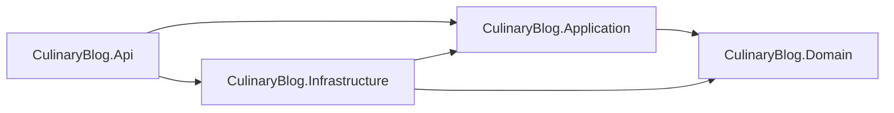

Tham chiếu API tới Infrastructure phục vụ composition root, không làm Application phụ thuộc EF Core hoặc MinIO. Các phép kiểm trong `DependencyDirectionTests.cs` kiểm tra Domain không tham chiếu thư viện ngoài nền tảng, Application không tham chiếu Infrastructure/API và Infrastructure không tham chiếu API.

## 2.2 CQRS và MediatR

CQRS phân biệt yêu cầu đọc và yêu cầu làm thay đổi trạng thái. Trong dự án, các thao tác tạo, cập nhật và xuất bản được biểu diễn bằng command; các thao tác đọc danh mục, chi tiết, danh sách và tìm kiếm được biểu diễn bằng query. Việc phân biệt diễn ra ở mức xử lý ứng dụng; không có hai cơ sở dữ liệu đọc/ghi độc lập.

MediatR chuyển request tới handler tương ứng và cho phép áp dụng các pipeline behavior dùng chung. Chuỗi đăng ký thực tế gồm Logging, Validation, Authorization, Performance, Caching và CacheInvalidation. Không có `TransactionBehavior` trong chuỗi hiện tại; transaction được sử dụng tại các thao tác cần thiết trong hiện thực nghiệp vụ.

**Hình 2.2 Luồng xử lý ca sử dụng qua MediatR.** Caching có thể trả kết quả sớm cho request phù hợp; invalidation diễn ra sau khi thao tác ghi hoàn tất.

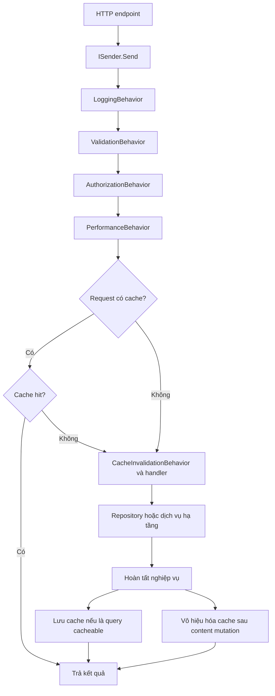

## 2.3 Công nghệ backend

| Công nghệ               | Phiên bản khai báo chính        | Vai trò trong dự án                                  |
| ----------------------- | ------------------------------- | ---------------------------------------------------- |
| .NET / C#               | `net10.0`, C# 14                | Nền tảng thực thi, bất đồng bộ, DI và hệ kiểu        |
| .NET SDK                | 10.0.402, cho phép latest patch | Môi trường build trong `backend/global.json`         |
| ASP.NET Core            | 10.x                            | Minimal API, middleware, JWT, policy và health check |
| EF Core                 | 10.0.13                         | Ánh xạ thực thể, truy vấn, migration và concurrency  |
| Npgsql EF provider      | 10.0.3                          | Kết nối PostgreSQL và dịch các biểu thức FTS/trigram |
| ASP.NET Core Identity   | 10.0.13                         | Tài khoản, mật khẩu, role, lockout và reset token    |
| MediatR                 | 12.5.0                          | Điều phối command/query và behavior                  |
| FluentValidation        | 12.1.1                          | Ràng buộc đầu vào của ca sử dụng                     |
| Hangfire ASP.NET Core   | 1.8.25                          | Hàng đợi bền vững, lịch và retry tác vụ              |
| MinIO SDK               | 7.0.0                           | Giao tiếp lưu trữ đối tượng S3                       |
| SkiaSharp / Magick.NET  | Theo quản lý package tập trung  | Giải mã, xử lý ảnh và hỗ trợ AVIF                    |
| Serilog / OpenTelemetry | Theo quản lý package tập trung  | Log cấu trúc, trace và metric                        |

Phiên bản được lấy từ `Directory.Build.props`, `Directory.Packages.props` và `global.json`; không lấy phiên bản .NET 9 trong báo cáo mẫu làm căn cứ cho hiện thực hiện tại.

## 2.4 Công nghệ frontend

| Công nghệ                           | Phiên bản khai báo | Vai trò                                                    |
| ----------------------------------- | ------------------ | ---------------------------------------------------------- |
| Next.js                             | 15.5.28            | App Router, trang phía máy chủ, route handlers và metadata |
| React / React DOM                   | 19.3.0             | Thành phần giao diện và tương tác                          |
| TypeScript                          | Theo lockfile      | Hợp đồng kiểu và kiểm tra khi phát triển                   |
| Tailwind CSS                        | Hệ 4.x             | Định dạng và bố cục responsive                             |
| TanStack Query                      | 5.102.8            | Tải dữ liệu, query key, mutation và invalidation           |
| Auth.js / next-auth                 | 5.0.0-beta.32      | Tích hợp phiên đăng nhập và Google provider                |
| React Hook Form / Zod               | 7.87.0 / 4.6.7     | Biểu mẫu và kiểm tra dữ liệu                               |
| Axios                               | 1.20.0             | API client, gắn bearer token và thử lại sau refresh        |
| dnd-kit                             | Theo từng package  | Thao tác kéo thả và sắp xếp nội dung                       |
| React Markdown                      | 10.1.0             | Hiển thị nội dung Markdown                                 |
| Playwright / Jest / Testing Library | Theo lockfile      | Kiểm thử browser và thành phần                             |

Server Components phù hợp với phần nội dung công khai cần HTML và metadata. Client Components phục vụ biểu mẫu, dashboard, bộ lọc và xử lý trạng thái tương tác. Phân chia này cho phép cân bằng khả năng lập chỉ mục và nhu cầu tương tác mà không giả định toàn bộ trang đều có cùng chiến lược render.

## 2.5 PostgreSQL và tìm kiếm tiếng Việt

PostgreSQL lưu tài khoản, công thức, danh mục, thành phần công thức, token và outbox. Các ràng buộc FK, unique index, check constraint và transaction bảo vệ dữ liệu ở tầng lưu trữ. EF Core migration quản lý sự tiến hóa schema.

FTS sử dụng `tsvector`, cấu hình `simple` và extension `unaccent`. Tiêu đề có trọng số A, mô tả có trọng số B. `SearchTitle` lưu tiêu đề đã chuẩn hóa để hỗ trợ tìm gần đúng với `pg_trgm`. Các chỉ mục GIN hỗ trợ hai kiểu tìm kiếm này; các chỉ mục B-tree phục vụ lọc và sắp xếp.

`SearchVector` được duy trì bằng trigger khi tiêu đề hoặc mô tả thay đổi. Không nên gọi đây là cột generated trực tiếp từ `unaccent`, vì migration thực tế tạo hàm trigger. Phạm vi FTS được xác nhận là tiêu đề và mô tả; chưa có căn cứ để khẳng định tên nguyên liệu được lập chỉ mục trong vector này.

## 2.6 Cache và xử lý bất đồng bộ

Redis phục vụ data cache, HTTP output cache, khóa phân tán và Pub/Sub. Các khóa cache chứa tham số lọc, sắp xếp, phân trang để tránh dùng nhầm kết quả. Nhãn cache và generation của nội dung công khai hỗ trợ vô hiệu hóa khi dữ liệu thay đổi.

Hangfire sử dụng PostgreSQL để lưu trạng thái công việc. Outbox ghi nhận ý định xử lý vào cơ sở dữ liệu trước khi worker điều phối công việc. Cách này giảm nguy cơ bản ghi nghiệp vụ đã lưu nhưng công việc nền bị bỏ sót vì lỗi tại thời điểm enqueue. Tác vụ được thiết kế để kiểm tra trạng thái trước khi thực hiện lại; riêng gửi SMTP vẫn có cửa sổ lỗi khiến thư có thể lặp nếu nhà cung cấp đã nhận nhưng transaction đánh dấu chưa hoàn tất.

## 2.7 Bảo mật, SEO và khả năng quan sát

Các lớp bảo vệ gồm băm mật khẩu Identity, xác thực JWT, kiểm tra tài khoản đang hoạt động, policy vai trò, quyền sở hữu, rate limit, giới hạn upload, xác minh định dạng ảnh, CORS và security headers. ETag bổ sung bảo vệ tính nhất quán khi cập nhật đồng thời; đây không phải cơ chế phân quyền.

SEO được hiện thực bằng metadata, canonical URL, Open Graph, Twitter card, robots và JSON-LD dạng Recipe. Sitemap được sinh theo nội dung công khai. Serilog, correlation ID, trace và metric giúp kết nối một HTTP request với thao tác dữ liệu và công việc nền phát sinh.

<a id="chuong-3"></a>

# CHƯƠNG 3 PHÂN TÍCH VÀ THIẾT KẾ HỆ THỐNG

## 3.1 Yêu cầu chức năng

Các mã `BC-*` dưới đây phục vụ truy vết trong báo cáo, không thay thế mã FR của SRS gốc.

| Mã          | Phân hệ            | Yêu cầu                                                      |
| ----------- | ------------------ | ------------------------------------------------------------ |
| BC-AUTH-01  | Xác thực           | Đăng ký email, kiểm tra trùng, gán Author và tạo phiên       |
| BC-AUTH-02  | Xác thực           | Đăng nhập, xử lý sai mật khẩu và khóa tạm                    |
| BC-AUTH-03  | Xác thực           | Xoay vòng refresh token, phát hiện dùng lại, đăng xuất       |
| BC-AUTH-04  | Xác thực           | Đăng nhập Google khi được cấu hình                           |
| BC-USER-01  | Hồ sơ              | Xem/sửa tên hiển thị, giới thiệu và ảnh đại diện             |
| BC-USER-02  | Mật khẩu           | Đổi mật khẩu; quên và đặt lại qua liên kết có hạn            |
| BC-CAT-01   | Danh mục           | Khách xem danh mục; Admin tạo, sửa và xóa mềm                |
| BC-RCP-01   | Công thức          | Tạo nháp, xem/sửa/xóa nội dung thuộc quyền                   |
| BC-RCP-02   | Thành phần         | Quản lý nguyên liệu và thứ tự các bước                       |
| BC-RCP-03   | Thời gian          | Phân loại bước prep/cook và suy ra thời gian tương ứng       |
| BC-RCP-04   | Xuất bản           | Publish, unpublish, archive và unarchive đúng trạng thái     |
| BC-FILE-01  | Ảnh                | Upload, kiểm tra ảnh, chọn ảnh chính, đổi metadata và xóa    |
| BC-DISC-01  | Khám phá           | Danh sách, chi tiết, tìm kiếm, lọc, sắp xếp và phân trang    |
| BC-ADMIN-01 | Quản trị           | Tra cứu toàn bộ công thức và danh sách người dùng            |
| BC-OBS-01   | Vận hành           | Audit, health, thông tin hệ thống và định danh release       |
| BC-JOB-01   | Tác vụ nền         | Thư chào mừng, resize ảnh, dọn đối tượng, sitemap và refresh |
| BC-SEO-01   | Nội dung công khai | Metadata, Recipe JSON-LD, robots và sitemap                  |

## 3.2 Yêu cầu phi chức năng

| Nhóm             | Yêu cầu thiết kế                                                | Cách đánh giá                                       |
| ---------------- | --------------------------------------------------------------- | --------------------------------------------------- |
| Bảo mật          | Chặn truy cập trái vai trò, trái chủ sở hữu, token không hợp lệ | Test 401/403, active-user, owner và token lifecycle |
| Toàn vẹn         | Không mất cập nhật; dữ liệu con hợp lệ                          | Test If-Match, ràng buộc DB và transaction          |
| Hiệu năng        | Tận dụng index, phân trang, projection và cache                 | Query plan, đo latency, cache hit theo workload     |
| Độ bền công việc | Có retry và theo dõi lỗi nền                                    | Test outbox, dừng dịch vụ phụ trợ, chạy lại job     |
| Khả năng sử dụng | Responsive, phản hồi tải/lỗi/rỗng và biểu mẫu rõ ràng           | Component test, E2E, axe và kiểm tra thủ công       |
| Bảo trì          | Ranh giới tầng và hợp đồng dữ liệu rõ                           | Architecture tests, lint, typecheck và OpenAPI      |
| Triển khai       | Khởi tạo môi trường bằng cấu hình versioned                     | Compose, health, seed và kiểm tra setup             |
| Quan sát         | Theo dõi được request và job                                    | Correlation ID, log, trace, metric và dashboard     |
| Khôi phục        | Có quy trình sao lưu, restore và rollback                       | Drill với artifact/dataset xác định                 |

Các ngưỡng SRS và các phép đo đã đạt phải được đọc cùng profile tài nguyên, dữ liệu và thời điểm. Có cấu hình giám sát hoặc có chỉ mục không tự chứng minh đạt SLA, độ trễ production hay khả năng mở rộng tuyến tính.

## 3.3 Quy tắc nghiệp vụ

1. Công thức mới được tạo ở trạng thái `Draft`.
2. Chỉ chủ sở hữu hoặc Admin mới được thực hiện các thao tác quản lý công thức theo kiểm tra backend.
3. Công thức công khai phải ở trạng thái `Published`, chưa xóa và thỏa điều kiện hiển thị của truy vấn công khai.
4. Publish yêu cầu dữ liệu chính hợp lệ, danh mục tồn tại, ít nhất một nguyên liệu và các bước được đánh số liên tục từ 1.
5. Công thức `Archived` phải được unarchive về `Draft` trước khi chỉnh sửa.
6. Unpublish đưa `Published` về `Draft`; unarchive không tự xuất bản lại.
7. Slug công thức có thể thay đổi trước lần xuất bản đầu; sau khi đã có `PublishedAt`, slug được giữ theo quy tắc miền.
8. Mỗi công thức có tối đa một ảnh chính chưa xóa, được bảo vệ bằng unique index có điều kiện.
9. Định lượng nguyên liệu nếu được cung cấp phải dương; thời gian bước nếu có phải không âm.
10. Thời gian chuẩn bị là tổng thời gian bước `prep`, thời gian nấu là tổng thời gian bước `cook`; tổng được làm tròn lên đơn vị phút hiển thị.
11. Mutation công thức và thành phần yêu cầu phiên bản hiện tại qua `If-Match` theo hợp đồng endpoint.
12. Xóa mềm ghi dấu và thông tin audit; không tương đương xóa vật lý tất cả dữ liệu liên quan.

## 3.4 Sơ đồ ngữ cảnh

**Hình 3.1 Ngữ cảnh hệ thống.** Các kho dữ liệu là thành phần nội bộ nên chưa tách ra ở mức này.

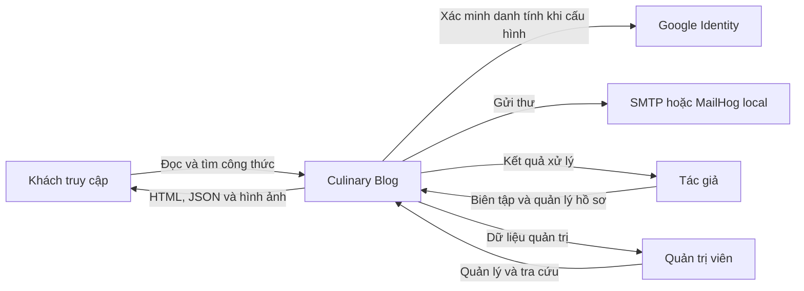

## 3.5 Sơ đồ các khối thực thi

**Hình 3.2 Kiến trúc khối thực thi của môi trường Docker local.** Sơ đồ theo mức container của C4 nhưng dùng cú pháp flowchart phổ thông để thuận tiện hiển thị Mermaid.

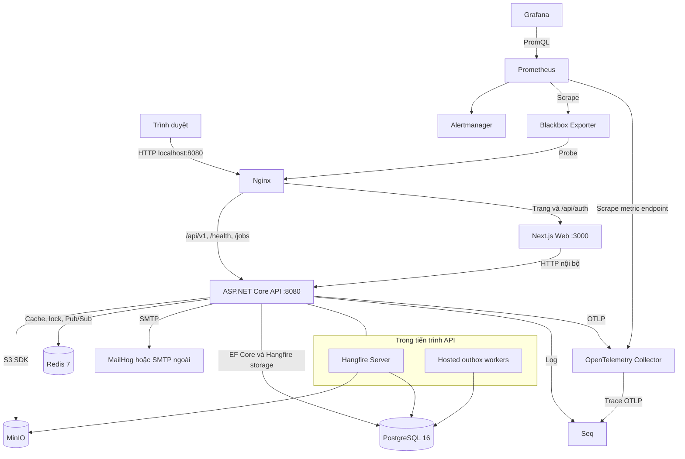

Redis không lưu thay dữ liệu nghiệp vụ; MinIO lưu byte ảnh, còn PostgreSQL lưu metadata và khóa đối tượng. Các công cụ giám sát không nằm trên đường xử lý bắt buộc của mọi yêu cầu đọc nội dung.

## 3.6 Sơ đồ use case

Mermaid không có loại sơ đồ UML use case gốc trong cú pháp phổ thông được dùng ở đây. Hai sơ đồ sau mô phỏng use case bằng flowchart: tác nhân là hình chữ nhật, ca sử dụng là hình bo tròn, khung là ranh giới hệ thống. Chúng không dùng cú pháp `usecaseDiagram` không được hỗ trợ.

**Hình 3.3 Use case công khai và tài khoản.**

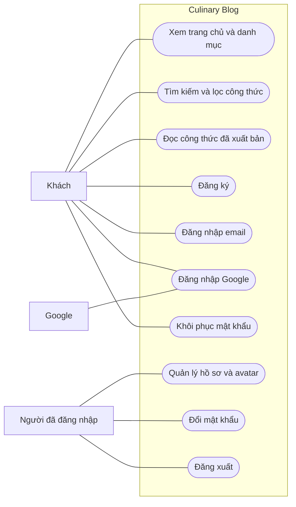

**Hình 3.4 Use case tác giả và quản trị viên.** Admin có thể dùng chức năng tác giả và được kiểm tra quyền ở từng thao tác.

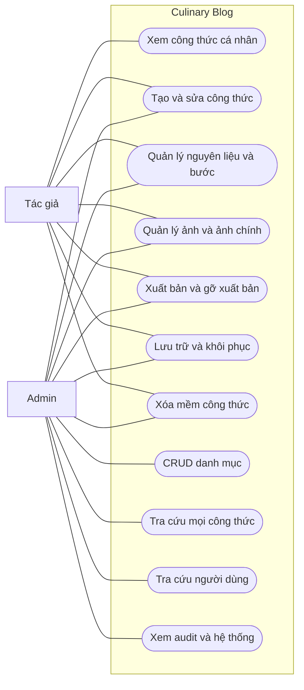

## 3.7 Đặc tả các ca sử dụng trọng tâm

### 3.7.1 UC01 Đăng ký tài khoản

**Tác nhân:** Khách. **Tiền điều kiện:** Dữ liệu tên, email và mật khẩu được cung cấp; email chưa thuộc tài khoản khác.

Luồng chính gồm nhập biểu mẫu; kiểm tra tại frontend; gửi API; kiểm tra lại bằng validator; tạo người dùng Identity; gán Author; ghi outbox thư chào mừng và tạo phiên; trả phản hồi; giao diện thiết lập trạng thái đăng nhập. Việc gửi thư diễn ra nền theo cấu hình email.

Ngoại lệ gồm dữ liệu không hợp lệ, email trùng, lỗi lưu dữ liệu hoặc lỗi hạ tầng. Email chào mừng không phải email xác minh bắt buộc hoặc OTP; không nên mô tả người dùng phải kích hoạt tài khoản bằng email nếu luồng hiện tại không yêu cầu.

**Hậu điều kiện:** Tài khoản được tạo và có dữ liệu phiên theo hợp đồng; ý định gửi thư có thể được xử lý sau.

### 3.7.2 UC02 Biên tập công thức

**Tác nhân:** Author hoặc Admin có quyền. **Tiền điều kiện:** Đã đăng nhập; công thức hiện hữu thuộc quyền thao tác và không ở trạng thái Archived khi sửa.

Tác giả lưu thông tin cơ bản để tạo bản nháp, sau đó thêm nguyên liệu, các bước sơ chế/nấu và hình ảnh. Mỗi lần sửa thành phần sử dụng phiên bản mới nhất của công thức. Hệ thống xác minh đầu vào, trạng thái, quyền sở hữu và `If-Match`, lưu thay đổi, tính lại thời gian khi cần rồi trả DTO và phiên bản mới.

Nếu phiên bản đã cũ, hệ thống báo xung đột; giao diện cần tải lại dữ liệu để người dùng xem và thao tác lại. Nếu công thức bị lưu trữ hoặc người dùng không có quyền, thao tác không được thực hiện.

**Hậu điều kiện:** Bản nháp hoặc nội dung đang biên tập được lưu; việc lưu nháp chưa đủ để công khai.

### 3.7.3 UC03 Xuất bản công thức

**Tiền điều kiện:** Công thức Draft; dữ liệu hợp lệ; danh mục còn tồn tại; có nguyên liệu; các bước liên tục; phiên bản khớp.

API kiểm tra xác thực, quyền và phiên bản; phương thức miền `Publish` kiểm tra các bất biến; dữ liệu được chuyển sang Published và ghi thời điểm xuất bản nếu là lần đầu. Sau khi ghi thành công, hệ thống làm mới dữ liệu công khai, cache và lịch xử lý liên quan. Trang công khai sẽ đọc được công thức theo điều kiện truy vấn.

Nếu thiếu nguyên liệu hoặc bước, ca sử dụng kết thúc bằng lỗi nghiệp vụ và trạng thái giữ nguyên Draft. Nếu có cập nhật đồng thời, yêu cầu bị từ chối thay vì xuất bản trên một phiên bản ngoài dự kiến.

### 3.7.4 UC04 Tìm kiếm công thức

**Tác nhân:** Khách hoặc người dùng đã đăng nhập. Người dùng nhập từ khóa, chọn danh mục/độ khó/thời gian, chọn cách sắp xếp và trang. Hệ thống kiểm tra tham số, chỉ lấy tập dữ liệu công khai, tìm theo FTS và các nhánh mở rộng phù hợp, đếm tổng số, phân trang và trả DTO.

Trường hợp không có kết quả được hiển thị như trạng thái rỗng, không phải lỗi hệ thống. Tham số không hợp lệ có thể bị từ chối bằng lỗi validation. Tìm kiếm không được làm lộ bản nháp hoặc nội dung đã lưu trữ.

### 3.7.5 UC05 Khôi phục mật khẩu

Khách cung cấp email. Với tài khoản có mật khẩu và đủ điều kiện, hệ thống tạo token đặt lại được bảo vệ bởi Data Protection, gửi liên kết qua SMTP. Người dùng mở liên kết, nhập mật khẩu mới và gửi token về API. Token hợp lệ được dùng để đổi mật khẩu; các phiên liên quan bị thu hồi.

Liên kết có thời hạn 30 phút và mất hiệu lực sau khi reset thành công. Tài khoản chỉ dùng Google không được mặc định có mật khẩu nội bộ. Phản hồi yêu cầu khôi phục cần tránh tiết lộ tình trạng tồn tại email theo luồng hiện thực.

### 3.7.6 UC06 Quản lý danh mục và tra cứu quản trị

Admin tạo/sửa danh mục bằng tên, mô tả, URL ảnh và thứ tự. Hệ thống chuẩn hóa tên/slug, kiểm tra trùng và áp dụng xóa mềm khi xóa. Các danh mục vẫn phải tuân theo quy tắc tham chiếu công thức trong dịch vụ.

Tại trang người dùng, Admin tìm theo tên/email, lọc role và chuyển trang. Đây là ca sử dụng đọc danh bạ người dùng. Không có bước đổi role hoặc khóa người dùng trong đặc tả hiện thực của ca này.

## 3.8 Sơ đồ luồng dữ liệu mức phân rã

**Hình 3.5 Các tiến trình và kho dữ liệu chính.** Đây là DFD mô tả logic bằng Mermaid, không phải sơ đồ triển khai; các mũi tên biểu diễn dữ liệu trao đổi.

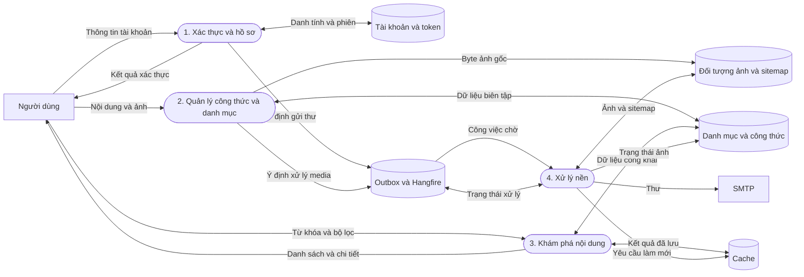

## 3.9 Thiết kế mô hình miền

`Recipe` chứa dữ liệu lõi và các phương thức bảo vệ vòng đời. `RecipeIngredient`, `RecipeStep` và `RecipeImage` có danh tính riêng, tham chiếu RecipeId và được thao tác qua ca sử dụng liên quan công thức. `RecipeNutrition` là value object sở hữu bởi Recipe, không có bảng riêng. `BaseEntity` chứa các thông tin audit, xóa mềm và phiên bản dùng chung.

**Hình 3.6 Sơ đồ lớp miền rút gọn.** Các liên kết thành phần biểu diễn quan hệ nghiệp vụ; không hàm ý `Recipe` khai báo navigation collection cho mọi bảng con.

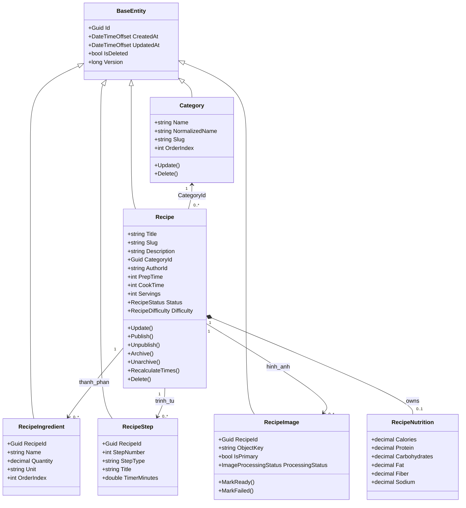

Sơ đồ rút gọn bỏ dấu nullable trong một số kiểu thuộc tính; từ điển dữ liệu phía dưới làm rõ trường tùy chọn. Tài khoản `ApplicationUser` được triển khai tại Infrastructure dựa trên Identity, không phải một thực thể Domain độc lập.

## 3.10 Thiết kế cơ sở dữ liệu

### 3.10.1 ERD nội dung

**Hình 3.7 Quan hệ dữ liệu công thức.** Tên bảng và các khóa chính/ngoại phản ánh cấu hình EF Core; các thuộc tính audit chung được lược bớt để sơ đồ dễ đọc.

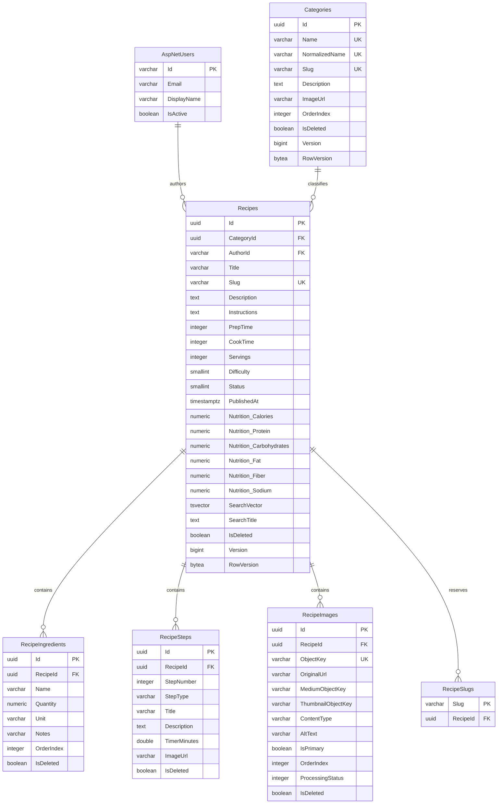

Một Recipe bắt buộc tham chiếu một Category và một tài khoản Author. Danh mục/tác giả có thể chưa có công thức. Recipe có thể chưa có nguyên liệu, bước hoặc ảnh khi đang là Draft; điều kiện publish được kiểm tra ở nghiệp vụ thay vì ép mọi Draft phải đầy đủ bằng quan hệ bắt buộc.

### 3.10.2 ERD xác thực và phân quyền

**Hình 3.8 Các bảng Identity và refresh token.** Sơ đồ bao gồm bảng liên kết và bảng phụ do Identity quản lý, không chỉ riêng hai role.

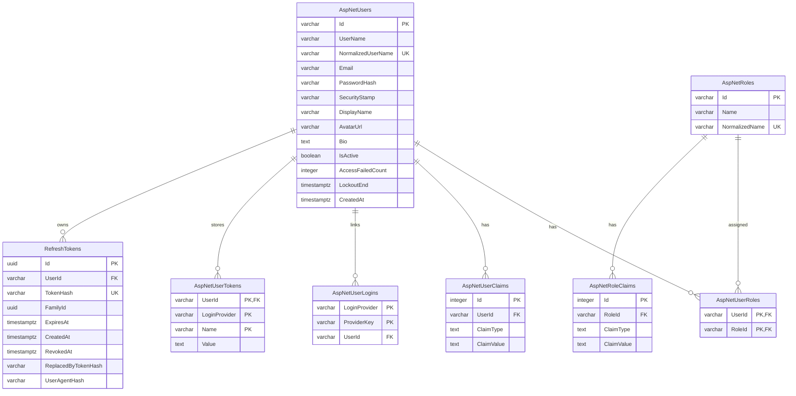

`ReplacedByTokenHash` là dấu vết luân chuyển token, không được vẽ như một FK tự tham chiếu khi cấu hình không khai báo quan hệ đó. Tương tự, role là dữ liệu trong bảng Roles và bảng liên kết, không phải cột role đơn trên AspNetUsers.

### 3.10.3 Dữ liệu hạ tầng và tác vụ nền

**Hình 3.9 Các cấu trúc dữ liệu vận hành.** Sơ đồ này cố ý không nối FK suy đoán: outbox lưu định danh/payload để xử lý; quan hệ logic với user/image không đồng nghĩa có ràng buộc FK trong schema.

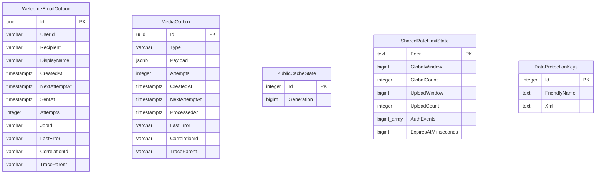

Hangfire còn quản lý schema/bảng nội bộ riêng. DataProtectionKeys sử dụng `DataProtectionKeyDbContext` khi bật lưu khóa ở database; nếu cấu hình đường dẫn tệp, khóa nằm ở volume tương ứng. Không phải mọi môi trường đều đồng thời sử dụng cả hai nơi lưu khóa. Audit hiện được ghi/đọc qua cơ chế log, không có căn cứ để thêm một bảng `AuditLogs` vào ERD.

### 3.10.4 Từ điển dữ liệu trọng tâm

| Thực thể/trường                       | Kiểu và ràng buộc đáng chú ý                    | Ý nghĩa                                              |
| ------------------------------------- | ----------------------------------------------- | ---------------------------------------------------- |
| `BaseEntity.Id`                       | UUID                                            | Danh tính của bản ghi miền                           |
| `CreatedAt`, `UpdatedAt`              | DateTimeOffset; UpdatedAt tùy chọn              | Dấu thời gian UTC                                    |
| `CreatedBy`, `UpdatedBy`, `DeletedBy` | Chuỗi tùy chọn                                  | Chủ thể thao tác; tác vụ nền có thể là system        |
| `IsDeleted`, `DeletedAt`              | Boolean và thời điểm tùy chọn                   | Xóa mềm và audit                                     |
| `Version`                             | bigint, khởi tạo 1                              | Phiên bản số cho ETag/concurrency                    |
| `RowVersion`                          | bytea tính từ `int8send("Version")`             | Shadow property concurrency của EF Core              |
| `Recipe.Title`                        | varchar(200), 5–200 ký tự sau trim              | Tiêu đề công thức                                    |
| `Recipe.Description`                  | text, 1–2000 ký tự                              | Mô tả ngắn                                           |
| `Recipe.Slug`                         | varchar(220), unique                            | Đường dẫn công khai                                  |
| `Recipe.PrepTime`, `CookTime`         | int không âm                                    | Phút chuẩn bị và nấu suy ra từ bước                  |
| `Recipe.Servings`                     | int > 0                                         | Khẩu phần                                            |
| `Recipe.Difficulty`                   | smallint 1–4                                    | Easy, Medium, Hard, Expert                           |
| `Recipe.Status`                       | smallint 0–2                                    | Draft, Published, Archived                           |
| `Nutrition_*`                         | numeric(8,2), tùy chọn, không âm                | Calories, protein, carbohydrates, fat, fiber, sodium |
| `Ingredient.Quantity`                 | numeric(10,3), tùy chọn; nếu có phải > 0        | Định lượng nguyên liệu                               |
| `Ingredient.Name`                     | DB tối đa 200; request validator tối đa 100     | Tên nguyên liệu; API có ràng buộc chặt hơn schema    |
| `Ingredient.Unit`, `Notes`            | Tối đa 50 và 500 ký tự                          | Đơn vị và ghi chú                                    |
| `Step.StepNumber`                     | int > 0, unique theo RecipeId với dòng chưa xóa | Thứ tự bước                                          |
| `Step.StepType`                       | varchar(4); API nhận prep hoặc cook             | Phân loại sơ chế hoặc chế biến                       |
| `Step.TimerMinutes`                   | double precision, tùy chọn, không âm            | Cho phép số phút thập phân                           |
| `Image.ObjectKey`                     | varchar(500), unique                            | Khóa đối tượng gốc                                   |
| `Image.IsPrimary`                     | Boolean, unique có điều kiện theo RecipeId      | Chọn ảnh chính                                       |
| `Image.ProcessingStatus`              | int 0–2                                         | Pending, Ready, Failed                               |
| `Category.Name`                       | DB tối đa 100; Domain kiểm tra 2–50             | Tên danh mục và ràng buộc thực thi                   |
| `Category.Slug`                       | varchar(120), unique                            | Đường dẫn danh mục                                   |
| `RefreshToken.TokenHash`              | Chuỗi băm, unique                               | Không lưu token thô tại DB                           |

Ràng buộc ở Domain/validator có thể chặt hơn dung lượng cột dữ liệu. Khi mô tả đầu vào được chấp nhận, phải dùng toàn bộ chuỗi kiểm tra, không suy chỉ từ độ dài cột.

### 3.10.5 Toàn vẹn, chỉ mục và xóa dữ liệu

FK từ Recipe tới Category và Author dùng `Restrict` khi xóa vật lý. Các bảng con RecipeIngredients, RecipeSteps, RecipeImages và RecipeSlugs tham chiếu Recipe; quan hệ vật lý được cấu hình cascade. Tuy nhiên, thao tác xóa nghiệp vụ dùng soft delete, nên không thể kết luận cascade vật lý tự chạy khi IsDeleted đổi sang true.

Các bộ lọc truy vấn mặc định bỏ bản ghi đã xóa. Unique index bảo vệ slug, tên danh mục và object key. Unique index có điều kiện bảo vệ ảnh chính và số bước đang hoạt động. Các chỉ mục `(Status, CreatedAt)`, `(Status, Title, Id)` và các tổ hợp bộ lọc giảm chi phí truy vấn phổ biến; hiệu quả thực tế phụ thuộc phân bố dữ liệu và kế hoạch truy vấn PostgreSQL chọn.

## 3.11 Sơ đồ trạng thái

### 3.11.1 Vòng đời công thức

**Hình 3.10 Trạng thái Recipe và xóa mềm.** SoftDeleted là trạng thái logic mô tả cờ IsDeleted, không phải giá trị thứ tư của enum RecipeStatus.

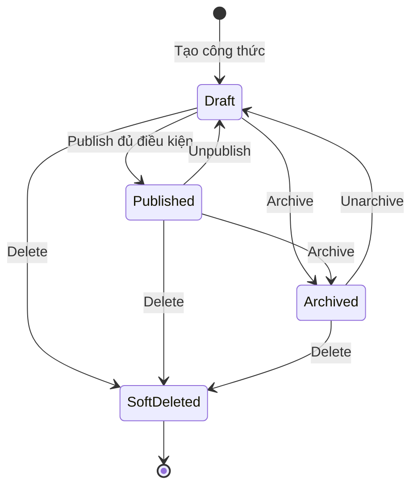

Việc cập nhật nội dung không tự chuyển trạng thái. Không có trạng thái PendingApproval hoặc quy trình duyệt bài trung gian trong enum hiện tại. `PublishedAt` được giữ sau unpublish, phục vụ quy tắc ổn định slug đã từng xuất bản.

### 3.11.2 Vòng đời xử lý ảnh

**Hình 3.11 Trạng thái xử lý ảnh.** “Đã xóa” là trạng thái logic; nhánh retry Failed về Ready không yêu cầu tạo thêm một trạng thái Processing trong enum.

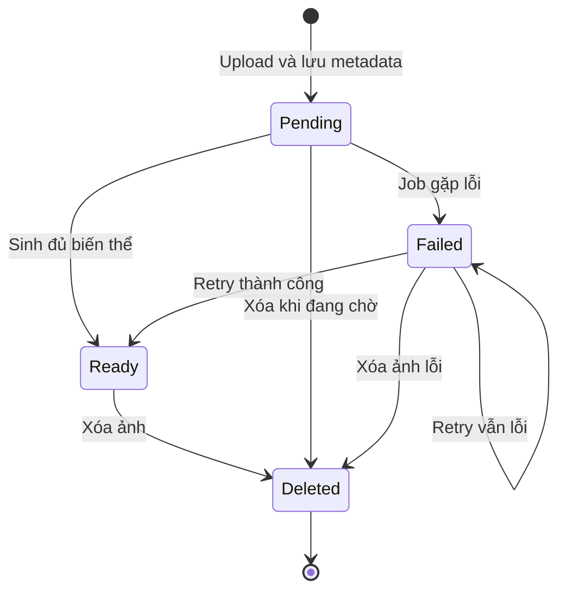

## 3.12 Sơ đồ tuần tự xác thực

### 3.12.1 Đăng ký và thư chào mừng

**Hình 3.12 Đăng ký với welcome-email outbox.** Luồng mô tả thứ tự nghiệp vụ tổng quát, không giả định SMTP nằm trong transaction tạo tài khoản.

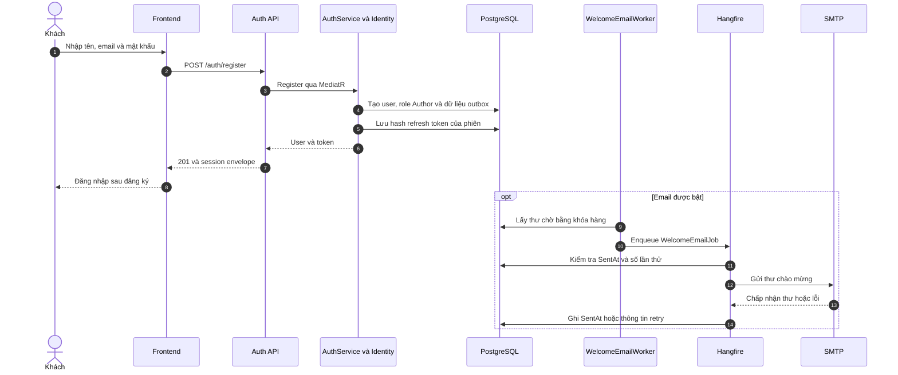

### 3.12.2 Đăng nhập, refresh và phát hiện dùng lại

**Hình 3.13 Vòng đời token của đăng nhập email.** Refresh token được truyền trong JSON và lưu ở sessionStorage trong frontend hiện tại; sơ đồ không gán token này cho cookie HttpOnly.

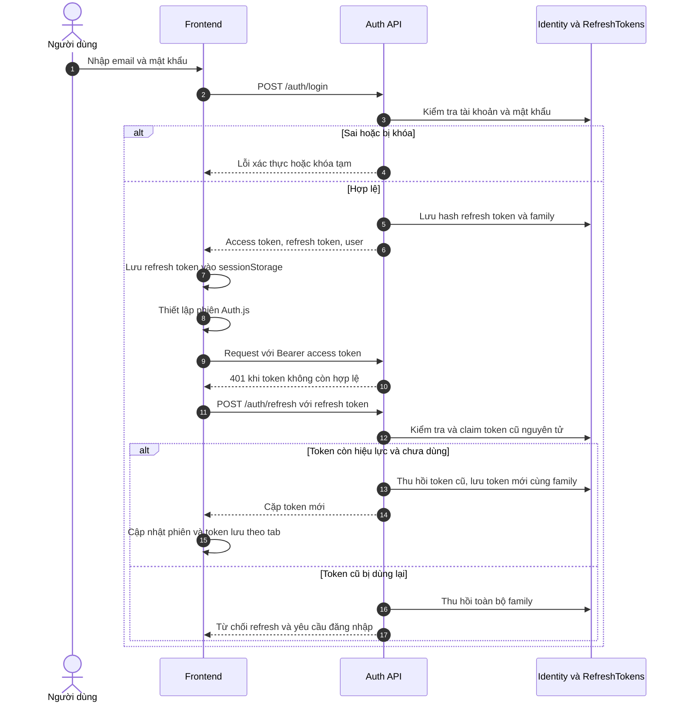

Auth.js quản lý thêm cookie phiên của chính frontend. Cookie này khác với refresh token backend trong sessionStorage. Với Google provider, callback phía server trao đổi ID token với backend và thu hồi refresh token vừa cấp theo luồng hiện tại; không nên mặc định mọi provider có cùng đường refresh như email.

### 3.12.3 Khôi phục mật khẩu

**Hình 3.14 Yêu cầu và sử dụng liên kết đặt lại mật khẩu.** Các bước SMTP được đơn giản hóa; lỗi cấu hình/gửi thư có thể tạo phản hồi lỗi theo dịch vụ hiện thực.

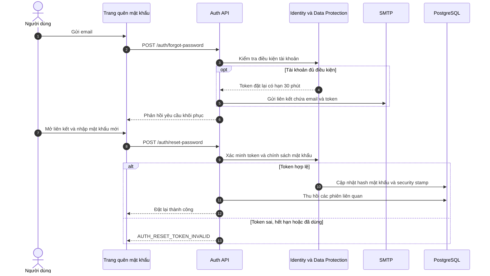

## 3.13 Sơ đồ hoạt động biên tập và xuất bản

**Hình 3.15 Luồng tác giả từ tạo nháp đến xuất bản.** Nhánh sửa bao gồm lưu dữ liệu và cập nhật phiên bản sau mỗi thao tác thành phần.

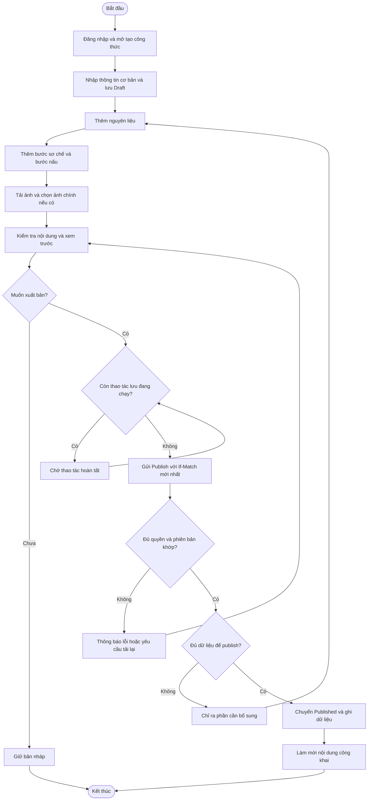

## 3.14 Kiểm soát cập nhật đồng thời

API trả strong ETag dạng số đặt trong dấu ngoặc kép, ví dụ `"7"`. Client gửi lại giá trị qua `If-Match`. Dịch vụ so sánh phiên bản; EF Core tiếp tục bảo vệ ở thời điểm ghi bằng concurrency token. Cập nhật thành phần cũng cần nâng phiên bản aggregate để hai thao tác trên các phần khác nhau không âm thầm dùng cùng một ảnh chụp dữ liệu cũ.

`RowVersion` là shadow property nhị phân được tính từ `Version`. Vì vậy, báo cáo không mô tả `xmin` là nguồn phiên bản hiện tại. Thiếu hoặc sai cú pháp If-Match được xử lý như lỗi đầu vào theo endpoint; phiên bản hợp lệ về cú pháp nhưng không khớp được trả `409 Conflict`, có thể kèm ETag hiện tại.

**Hình 3.16 Hai client cùng sửa một công thức.**

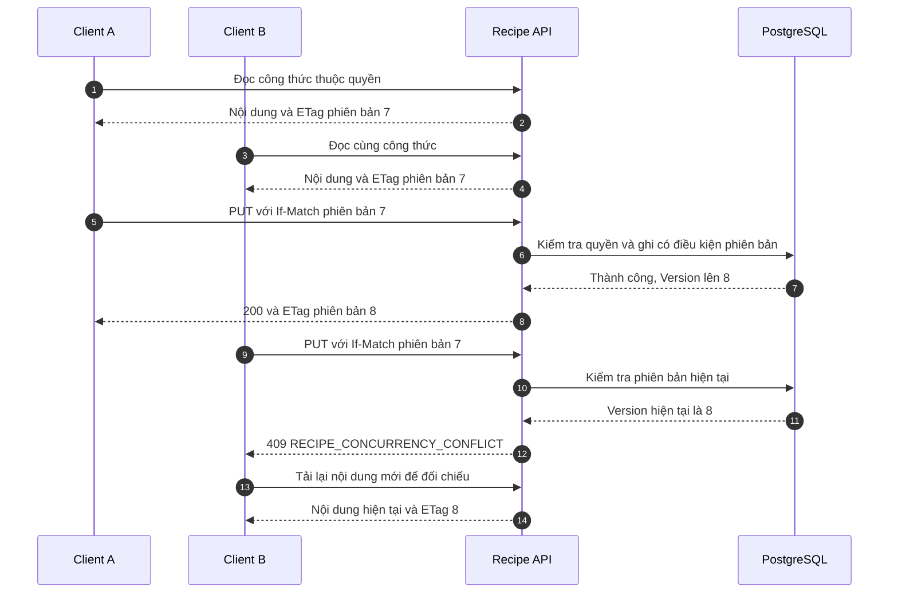

## 3.15 Tìm kiếm và lọc công thức

Truy vấn công khai bắt đầu từ tập Published và các điều kiện khả dụng liên quan. Từ khóa được chuẩn hóa, tách thành các thành phần có kiểm soát rồi tìm FTS. Mã tìm kiếm còn xử lý trường hợp khớp chính xác, tiền tố và lỗi gõ bằng trigram tùy điều kiện. `ts_rank` và độ tương tự tiêu đề phục vụ xếp hạng; sắp xếp ổn định và phân trang được áp dụng trước khi trả dữ liệu.

**Hình 3.17 Luồng tìm kiếm tiếng Việt.** Các nhánh FTS/prefix/trigram được gộp ở mức thuật toán tổng quát, không có nghĩa mọi truy vấn luôn chạy cả ba nhánh.

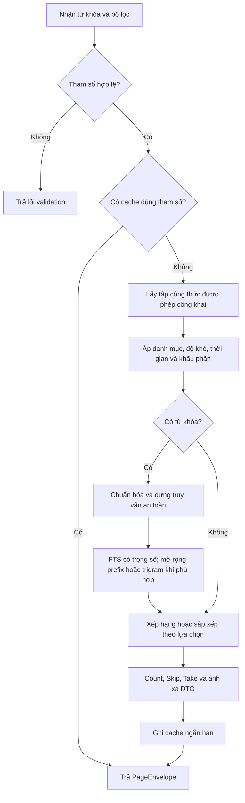

Các bộ lọc bao gồm danh mục/CategoryId, độ khó, giới hạn thời gian, thời gian nấu tối đa, khẩu phần tối thiểu và khoảng thời gian chuẩn bị theo query được hỗ trợ. `RecipeSort` chuẩn hóa các alias như newest/oldest/az/za và kiểm tra xung đột giữa `sort` với `sortBy`/`sortOrder`.

## 3.16 Upload và xử lý ảnh nền

Ảnh công thức được giới hạn 5 MiB, nhận JPEG, PNG, WebP và AVIF. Giới hạn multipart/Nginx lớn hơn để chứa phần overhead của form. Dịch vụ không chỉ tin tên tệp hay MIME từ client mà còn kiểm tra chữ ký, kích thước và khả năng giải mã; với đường giải mã thông thường có ngưỡng 40 triệu pixel.

Ảnh gốc được lưu trong MinIO; metadata và ý định xử lý được ghi ở PostgreSQL. Job tạo ảnh WebP medium 800×600 và thumbnail 300×300 trên canvas giữ tỷ lệ nguồn. Khi hoàn tất, job kiểm tra lại ảnh/công thức có bị xóa trong lúc upload biến thể hay không để tránh để lại kết quả không còn được sử dụng.

**Hình 3.18 Upload, media outbox và resize.** Luồng lỗi giữa MinIO và PostgreSQL cần cơ chế bù/dọn dẹp vì hai hệ thống không dùng chung một transaction ACID.

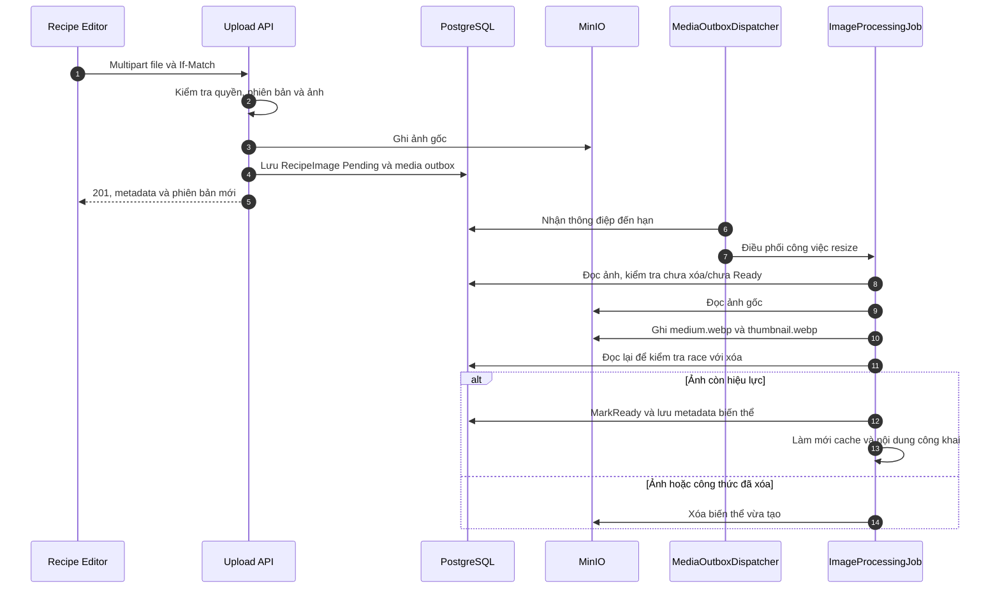

Không mở bucket đọc công khai cho mọi đối tượng. Endpoint media kiểm tra ngữ cảnh nội dung, đặc biệt với ảnh bản nháp; route cho phép anonymous ở metadata endpoint không đồng nghĩa mọi ảnh đều được truy cập vô điều kiện.

## 3.17 Cache, revalidation và đồng bộ nội dung

Có ba nhóm trạng thái cần phân biệt: cache dữ liệu/HTTP ở backend; cache/render nội dung công khai ở Next.js; dữ liệu server state của Client Components. Một thao tác ghi có thể yêu cầu làm mới nhiều nhóm, không thể chỉ xóa query cache trong tab hiện tại.

| Loại dữ liệu                  | TTL/đặc tính được khai báo      | Căn cứ                                         |
| ----------------------------- | ------------------------------- | ---------------------------------------------- |
| Output danh mục               | 30 phút                         | Presentation DI                                |
| Output danh sách công thức    | 15 phút                         | Presentation DI                                |
| Output chi tiết công thức     | 60 phút                         | Presentation DI                                |
| Output và query tìm kiếm      | 1 phút                          | Presentation DI và SearchPublishedRecipesQuery |
| Data cache chi tiết công thức | 5 phút                          | GetPublishedRecipeQuery                        |
| Dữ liệu riêng tư              | private, no-store theo pipeline | Program.cs và API client                       |

Generation nội dung công khai được lưu bền ở PostgreSQL để phối hợp nhiều API instance. Migration `PublishedContentCacheGeneration` giới hạn các thay đổi làm tăng generation theo nội dung công khai, tránh việc soạn Draft liên tục phá cache đọc công khai. Sau mutation, pipeline so sánh generation, xóa tag khi cần và yêu cầu xử lý refresh sau commit.

**Hình 3.19 Làm mới nội dung sau một mutation có tác động công khai.** Sơ đồ tổng hợp trách nhiệm của các thành phần, không ép tất cả bước chạy trong cùng transaction.

```mermaid
sequenceDiagram
    autonumber
    participant FE as Editor
    participant API as API và MediatR
    participant DB as PostgreSQL
    participant RC as Redis Cache
    participant SCHED as PublicContentRefreshScheduler
    participant JOB as PublicContentRefreshJob
    participant WEB as Next.js
    FE->>API: Mutation có If-Match
    API->>DB: Đọc generation trước ghi
    API->>DB: Lưu thay đổi nghiệp vụ
    DB->>DB: Trigger cập nhật generation nếu liên quan công khai
    API->>DB: Đọc generation sau commit
    opt Nội dung công khai thay đổi
        API->>RC: Xóa cache theo tag liên quan
    end
    API->>SCHED: Schedule refresh
    SCHED->>RC: Publish thông báo thay đổi
    SCHED->>JOB: Schedule job có debounce
    API-->>FE: Kết quả mutation
    JOB->>WEB: Callback /api/revalidate có secret
    WEB->>WEB: Revalidate dữ liệu hoặc trang liên quan
```

### 3.17.1 Thông báo thay đổi qua SSE

Endpoint `/api/v1/recipe-events` đăng ký kênh Redis `culinary:v1:recipe-changes`, gửi sự kiện `connected`, `changed` và heartbeat. Payload thay đổi là đối tượng rỗng; không phát trực tiếp nội dung bản nháp hay thông tin nhạy cảm. Client nhận sự kiện rồi làm mới dữ liệu theo quyền truy cập của chính mình.

**Hình 3.20 Đồng bộ nhiều tab qua sự kiện thay đổi.**

```mermaid
sequenceDiagram
    autonumber
    participant A as Tab biên tập
    participant API as API instance A
    participant R as Redis Pub/Sub
    participant SSE as API instance B
    participant B as Tab đọc
    B->>SSE: Mở EventSource qua route proxy
    SSE->>R: Subscribe kênh recipe-changes
    A->>API: Lưu thay đổi
    API-->>A: Mutation thành công
    Note over API,R: Luồng refresh phát thông báo sau thay đổi
    API->>R: Publish thông báo thay đổi
    R-->>SSE: Thông điệp thay đổi
    SSE-->>B: event changed, data rỗng
    B->>B: Invalidate và tải lại dữ liệu liên quan
    B->>API: GET với quyền truy cập hiện tại
    API-->>B: Dữ liệu được phép xem
```

SSE là cơ chế thông báo, không phải bảo đảm giao nhận bền vững mọi sự kiện. Client vẫn cần refetch, xử lý reconnect và tôn trọng trạng thái cache/dữ liệu thực tế.

## 3.18 Thiết kế bảo mật và xử lý lỗi

### 3.18.1 Ma trận phân quyền

| Chức năng                           | Guest             | Author             | Admin                          |
| ----------------------------------- | ----------------- | ------------------ | ------------------------------ |
| Đọc nội dung công khai              | Có                | Có                 | Có                             |
| Đăng ký/đăng nhập/khôi phục         | Có theo điều kiện | Có theo ngữ cảnh   | Có theo ngữ cảnh               |
| Sửa hồ sơ                           | Không             | Hồ sơ mình         | Hồ sơ mình                     |
| Tạo công thức                       | Không             | Có                 | Có                             |
| Sửa/xóa/chuyển trạng thái công thức | Không             | Công thức của mình | Theo quyền quản trị            |
| Đọc bản nháp                        | Không             | Bản nháp của mình  | Qua endpoint quản trị có quyền |
| CRUD danh mục                       | Không             | Không              | Có                             |
| Xem danh sách người dùng và audit   | Không             | Không              | Có                             |
| Xem trang tác vụ nền                | Không             | Không              | Theo xác thực dashboard        |

`ActiveUserRequirement` bổ sung kiểm tra trạng thái tài khoản; `RecipeOwnerRequirement` và các bước kiểm tra quyền liên quan bảo vệ tài nguyên cụ thể. Các endpoint riêng tư không dùng cache công khai để chia sẻ dữ liệu giữa người dùng.

### 3.18.2 Chính sách mật khẩu và phiên

Mật khẩu tối thiểu 8 ký tự, có chữ thường, chữ hoa, chữ số và ký tự đặc biệt theo cấu hình Identity. Sau 5 lần đăng nhập sai, tài khoản bị khóa tạm 15 phút. Access token mặc định 15 phút; refresh token mặc định 7 ngày. JWT được kiểm tra issuer, audience, chữ ký, lifetime và có sai lệch đồng hồ cho phép 30 giây.

Database chỉ lưu hash refresh token; family hỗ trợ thu hồi khi phát hiện tái sử dụng. Đổi/đặt lại mật khẩu cập nhật trạng thái bảo mật và thu hồi phiên. Tuy nhiên, refresh token trong sessionStorage vẫn có thể bị JavaScript cùng origin đọc khi có XSS; đây là hạn chế cần ưu tiên xử lý, không thể gọi cấu trúc hiện tại là bảo vệ refresh token bằng HttpOnly.

### 3.18.3 Giới hạn tần suất

Giới hạn mặc định gồm 100 request/phút/IP toàn cục, nhóm auth 10 request trong cửa sổ trượt một phút và nhóm upload 5 request/phút. Health được miễn trong limiter. PostgreSQL giữ ledger/quota dùng chung trước khi Redis được cập nhật, nhằm duy trì giới hạn khi Redis lỗi hoặc khôi phục; vì vậy cơ chế hiện tại vẫn tạo tải lên PostgreSQL và cần được đo trong workload thực.

Phản hồi có các header `X-RateLimit-Limit`, `X-RateLimit-Remaining`, `X-RateLimit-Reset`; khi bị từ chối có `Retry-After` và mã 429. Địa chỉ IP phụ thuộc thiết lập forwarded headers đúng với proxy đáng tin cậy.

### 3.18.4 Chuẩn phản hồi lỗi

API dùng Problem Details có `type`, `title`, `status`, `detail`, `instance`, bổ sung `code` và định danh truy vết. Validation có thể có `errors` theo trường; xung đột phiên bản có thể có `currentETag`.

| HTTP | Trường hợp tiêu biểu                                            |
| ---- | --------------------------------------------------------------- |
| 400  | Yêu cầu sai định dạng; mật khẩu hiện tại sai; token reset sai   |
| 401  | Chưa xác thực, access token hoặc refresh token không hợp lệ     |
| 403  | Không đủ quyền, sai chủ sở hữu, tài khoản bị vô hiệu hóa        |
| 404  | Không tìm thấy hoặc tài nguyên không được công khai             |
| 409  | Email trùng, xung đột phiên bản, chuyển trạng thái không hợp lệ |
| 422  | Validation hoặc vi phạm quy tắc nghiệp vụ tương ứng             |
| 423  | Tài khoản bị khóa tạm do đăng nhập sai                          |
| 429  | Vượt giới hạn tần suất                                          |
| 500  | Lỗi không dự kiến; phản hồi không lộ chi tiết nội bộ            |
| 503  | Một số dịch vụ/tích hợp chưa được cấu hình hoặc không khả dụng  |

## 3.19 Thiết kế điều hướng giao diện

**Hình 3.21 Bản đồ màn hình chính.** Phân nhánh dựa trên quyền và route thực tế; dashboard recipes có nội dung thích ứng với vai trò.

```mermaid
flowchart TD
    H["Trang chủ /"] --> L["Danh sách /recipes"]
    H --> S["Tìm kiếm /search"]
    H --> C["Danh mục /categories"]
    C --> CD["/categories/slug"]
    L --> D["Chi tiết /recipes/slug"]
    S --> D
    CD --> D
    H --> LG["/login hoặc /auth/login"]
    LG --> RG["/register hoặc /auth/register"]
    LG --> FP["/forgot-password"]
    FP --> RP["/reset-password"]
    LG --> DA["/dashboard"]
    DA --> PR["/profile"]
    DA --> MR["/dashboard/recipes"]
    MR --> NEW["/dashboard/recipes/new"]
    MR --> EDIT["/dashboard/recipes/id/edit"]
    EDIT --> PRE["/dashboard/recipes/id/preview"]
    DA --> ADMIN{"Có quyền Admin?"}
    ADMIN -->|Có| CA["/dashboard/categories"]
    ADMIN -->|Có| US["/dashboard/users"]
    ADMIN -->|Có| AU["/dashboard/audit"]
    ADMIN -->|Có| SY["/dashboard/system"]
```

<a id="chuong-4"></a>

# CHƯƠNG 4 HIỆN THỰC VÀ HƯỚNG DẪN CÀI ĐẶT

## 4.1 Tổ chức mã nguồn

```text
Culinary_Blog/
├── frontend/
│   ├── src/app/                  Route, layout và route handlers Next.js
│   ├── src/features/culinary/    Trang và chức năng nghiệp vụ
│   ├── src/lib/                  API client, SEO và tiện ích
│   ├── src/auth.ts               Cấu hình Auth.js
│   ├── tests/                    Node và component tests
│   └── e2e/                      Luồng Playwright
├── backend/
│   ├── src/CulinaryBlog.Domain/
│   ├── src/CulinaryBlog.Application/
│   ├── src/CulinaryBlog.Infrastructure/
│   ├── src/CulinaryBlog.Api/
│   ├── tests/CulinaryBlog.UnitTests/
│   ├── tests/CulinaryBlog.ArchitectureTests/
│   └── tests/CulinaryBlog.IntegrationTests/
├── infra/                        Nginx, quan sát, testing và production
├── performance/                  Kịch bản và cấu hình đánh giá hiệu năng
├── security/                     Cấu hình, dữ liệu phục vụ kiểm tra bảo mật
├── scripts/                      Verification, vận hành và release
├── docs/                         Đặc tả, kế hoạch, quyết định và bằng chứng
├── .github/workflows/            Kiểm tra CI và quy trình phát hành
├── compose.yaml                 Môi trường Docker local
└── compose.dev.yaml              Ghi đè cấu hình phát triển
```

### 4.1.1 Quy mô mã nguồn khảo sát

Bảng được đếm trực tiếp ngày 19/11/2026. Backend chỉ đếm tệp `.cs`, loại `bin/obj`; frontend chỉ đếm `.ts`, `.tsx`, `.css` trong `src`. Dòng được tính theo dòng văn bản, gồm comment, dòng trống, migration/snapshot và mã sinh nằm trong phạm vi tương ứng. Số dòng không phải thước đo chất lượng hoặc công sức.

| Khu vực                                   |  Số tệp |    Số dòng |
| ----------------------------------------- | ------: | ---------: |
| Domain                                    |      14 |        902 |
| Application                               |     208 |      5.072 |
| Infrastructure, gồm migration/snapshot    |     116 |     22.908 |
| API                                       |      21 |      3.085 |
| Ba project kiểm thử backend               |      76 |     11.313 |
| Frontend src, gồm khai báo kiểu được sinh |     110 |     14.673 |
| **Tổng theo phạm vi đếm trên**            | **545** | **57.953** |

## 4.2 Hiện thực backend

### 4.2.1 API và middleware

`Program.cs` ghép Application, Infrastructure, Presentation, tài liệu API và telemetry. Pipeline cấu hình xử lý forwarded headers nếu bật; HSTS ở Production; correlation ID; request logging; exception handler; CORS; rate limiter; authentication; authorization; quy tắc cache riêng tư; output cache và audit mutation.

Các endpoint chủ yếu nằm trong `AuthEndpoints`, `ContentEndpoints`, `AdminUsersEndpoints` và `RecipeEventsEndpoint`. Đầu vào được chuyển thành command/query qua `ISender`. GlobalExceptionHandler chuẩn hóa lỗi, không trả stack trace ra client khi lỗi hệ thống.

OpenAPI và Scalar chỉ được map ở Development hoặc Testing. Điều này phải được tính đến khi demo trên môi trường khác: không mở `/scalar` ở production không phải lỗi nếu đó là chính sách môi trường.

### 4.2.2 Persistence và audit

`AppDbContext` kế thừa IdentityDbContext và đăng ký mapping từ assembly. Các cấu hình riêng định nghĩa bảng, khóa, quan hệ, kiểu cột, chỉ mục và query filter. `AuditSaveChangesInterceptor` gán thời gian, chủ thể tạo/sửa/xóa và tăng phiên bản khi thực thể thay đổi. Outbox có thông tin correlation/trace để liên hệ với request khởi phát.

Repository và UnitOfWork cung cấp cổng lưu trữ theo abstraction Application. Một số nghiệp vụ nội dung được tập trung trong ContentService và các partial file Composition/SearchPredicates. Đây là phân chia hiện thực hiện có; chưa thể coi mọi ca sử dụng đã có repository độc lập hoặc mọi transaction được tự động hóa ở behavior.

### 4.2.3 Tính thời gian từ các bước

`RecipeStep.StepType` phân biệt `prep` và `cook`; `TimerMinutes` cho phép phần thập phân. Khi cập nhật cấu trúc bước, hệ thống tính thời gian từ các bước chưa xóa:

```text
PrepTime = ceil(tổng TimerMinutes của bước có StepType = prep)
CookTime = ceil(tổng TimerMinutes của bước có StepType = cook)
```

Giá trị thiếu thời gian được tính là 0 trong phép tổng. Kết quả được chặn trong giới hạn int. Ví dụ hai bước sơ chế 1,5 và 2 phút cho thời gian chuẩn bị hiển thị 4 phút; bước nấu 10,25 phút cho thời gian nấu 11 phút. Đây là tổng thời gian theo các bước, chưa mô hình hóa các thao tác thực hiện song song.

Migration `ClassifiedStepTimes` bổ sung StepType, mặc định các bước cũ là cook và cập nhật lại thời gian công thức từ dữ liệu bước. Do đó kết quả thời gian của dữ liệu trước migration có thể thay đổi sau nâng cấp.

### 4.2.4 Tác vụ nền và lịch

| Thành phần               | Công việc                               | Đặc điểm                                                  |
| ------------------------ | --------------------------------------- | --------------------------------------------------------- |
| WelcomeEmailWorker       | Chọn outbox thư đến hạn và enqueue      | Poll khoảng 15 giây; dùng khóa hàng/SKIP LOCKED           |
| WelcomeEmailJob          | Gửi thư chào mừng                       | Retry tối đa 3 lần với lịch 60/300/1800 giây; kiểm SentAt |
| MediaOutboxDispatcher    | Điều phối thông điệp media              | Dựa vào trạng thái xử lý và lần thử                       |
| ImageProcessingJob       | Tạo medium và thumbnail WebP            | Có retry; bỏ qua ảnh đã Ready hoặc không còn hiệu lực     |
| ObjectDeletionJob        | Dọn đối tượng ảnh                       | Hỗ trợ xử lý xóa bất đồng bộ                              |
| ImageReconciliationJob   | Đối soát dữ liệu ảnh                    | Lịch daily trong đăng ký hiện tại                         |
| SitemapGenerationJob     | Sinh sitemap từ nội dung được công khai | Khi khởi động nếu bật jobs và lịch 02:00 UTC hằng ngày    |
| PublicContentRefreshJob  | Sinh sitemap và callback revalidation   | Debounce, tránh chạy đồng thời, retry riêng               |
| RateLimitStateCleanupJob | Dọn trạng thái quota hết hạn            | Mỗi phút                                                  |

Lịch sitemap 02:00 UTC tương ứng 09:00 tại Asia/Bangkok. Trạng thái bật/tắt background jobs phụ thuộc cấu hình. Khi tắt worker, API có thể vẫn lưu metadata hoặc outbox nhưng công việc chờ không tự hoàn thành cho tới khi được xử lý.

## 4.3 Hiện thực frontend

### 4.3.1 Phân vùng giao diện

Route groups tách giao diện công khai, xác thực và dashboard. Layout xác định shell và kiểm tra ngữ cảnh truy cập. Các trang nghiệp vụ nằm trong `features/culinary/pages`; các biểu mẫu dùng chung ràng buộc và thông báo trong `features/culinary/forms`.

TanStack Query quản lý dữ liệu server ở các màn hình tương tác. Query key chứa điều kiện tìm kiếm/lọc/phân trang và ở các trang riêng tư còn gắn ngữ cảnh người dùng. Axios interceptor lấy access token từ phiên Auth.js; nếu nhận 401, cơ chế refresh được cấu hình có thể cập nhật phiên và thử lại một lần.

### 4.3.2 Bộ biên tập công thức năm bước

| Bước                    | Nội dung                                                            | Điều kiện/đầu ra                                                 |
| ----------------------- | ------------------------------------------------------------------- | ---------------------------------------------------------------- |
| 1 Thông tin cơ bản      | Tiêu đề, mô tả, danh mục, độ khó, khẩu phần và dinh dưỡng liên quan | Tạo hoặc cập nhật bản nháp                                       |
| 2 Nguyên liệu           | Tên, lượng, đơn vị, ghi chú và thứ tự                               | Thành phần được lưu với phiên bản công thức mới                  |
| 3 Các bước              | Hướng dẫn, loại prep/cook, thời gian và thứ tự                      | Tính lại thời gian; bảo vệ số bước                               |
| 4 Hình ảnh              | Upload, ảnh chính, alt và sắp xếp                                   | Metadata ảnh và trạng thái xử lý                                 |
| 5 Xem trước và xuất bản | Tổng hợp lỗi/thiếu, xem trước, chuyển trạng thái                    | Chỉ publish khi đủ điều kiện và không còn thao tác lưu đang chạy |

Giao diện theo dõi dữ liệu đã sửa, yêu cầu xác nhận phù hợp khi chuyển phần và khóa thao tác trạng thái trong lúc cập nhật. Điều này giảm tình huống người dùng bấm xuất bản khi mutation thành phần chưa trả về phiên bản mới. Backend vẫn là nơi kiểm tra quyết định cuối cùng.

### 4.3.3 Hồ sơ và dashboard

Trang hồ sơ cho phép sửa tên hiển thị, bio và avatar; biểu mẫu mật khẩu xử lý trường hợp tài khoản có/không có mật khẩu nội bộ. Dashboard Author trình bày dữ liệu cá nhân và công thức của mình. Dashboard Admin có các trang danh mục, công thức, người dùng, audit và hệ thống.

Danh sách người dùng hiển thị tên, email, vai trò, trạng thái hoạt động và ngày tạo. Trên màn hình rộng dùng bảng; trên màn hình hẹp có cách trình bày danh sách. Tìm kiếm chỉ được áp dụng theo thao tác gửi form, kết hợp role và kích thước trang; dữ liệu không chứa hash mật khẩu hoặc refresh token.

### 4.3.4 SEO và nội dung công khai

`seo.ts` dựng tiêu đề, mô tả, canonical, ảnh chia sẻ, Open Graph và Twitter card. JSON-LD Recipe có tên, mô tả, ảnh, tác giả, thời gian, khẩu phần, nguyên liệu và HowToStep theo dữ liệu công thức. Dinh dưỡng chỉ được đưa vào khi có giá trị tương ứng; không tạo đánh giá sao giả.

`robots.ts` cung cấp quy tắc crawl và đường dẫn sitemap. Việc không cho crawler lập chỉ mục dashboard chỉ là hướng dẫn crawler; quyền truy cập vẫn phải được kiểm tra ở ứng dụng. Sitemap có thể được Nginx chuyển đến endpoint backend; cần dùng SITE_URL đúng môi trường để URL sinh ra không trỏ về localhost trong bản công khai.

## 4.4 Danh mục API chính

Các đường dẫn dưới đây có tiền tố `/api/v1`. `Author + owner` có nghĩa policy cho phép Author/Admin và nghiệp vụ tiếp tục xác minh quyền trên công thức. Giá trị `{id}` là GUID tại các endpoint công thức/danh mục được ràng buộc tương ứng.

### 4.4.1 Xác thực và hồ sơ

| Method | Đường dẫn                      | Quyền/điều kiện                | Mục đích                              |
| ------ | ------------------------------ | ------------------------------ | ------------------------------------- |
| POST   | `/auth/register`               | Công khai, rate limit auth     | Đăng ký                               |
| POST   | `/auth/login`                  | Công khai, rate limit auth     | Đăng nhập email                       |
| POST   | `/auth/google`                 | Công khai, cần cấu hình Google | Đổi ID token lấy phiên backend        |
| POST   | `/auth/refresh`                | Refresh token hợp lệ           | Xoay vòng phiên                       |
| POST   | `/auth/logout`                 | Token/phiên theo hợp đồng      | Thu hồi refresh token/phiên liên quan |
| POST   | `/auth/change-password`        | Author/Admin                   | Đổi mật khẩu                          |
| POST   | `/auth/forgot-password`        | Công khai                      | Gửi yêu cầu khôi phục                 |
| POST   | `/auth/reset-password`         | Token reset hợp lệ             | Đặt mật khẩu mới                      |
| GET    | `/auth/me`                     | Author/Admin                   | Đọc hồ sơ                             |
| PATCH  | `/auth/me`                     | Author/Admin                   | Sửa hồ sơ                             |
| POST   | `/auth/me/avatar`              | Author/Admin, upload limit     | Upload avatar và dữ liệu hồ sơ        |
| GET    | `/avatars/{userId}/{fileName}` | Theo quy tắc media avatar      | Đọc ảnh đại diện                      |

### 4.4.2 Danh mục và công thức

| Method | Đường dẫn                 | Quyền          | Lưu ý                              |
| ------ | ------------------------- | -------------- | ---------------------------------- |
| GET    | `/categories/`            | Công khai      | Danh sách danh mục                 |
| GET    | `/categories/{slug}`      | Công khai      | Chi tiết và nội dung theo danh mục |
| POST   | `/categories/`            | Admin          | Tạo danh mục                       |
| PUT    | `/categories/{id}`        | Admin          | Sửa danh mục                       |
| DELETE | `/categories/{id}`        | Admin          | Xóa mềm theo quy tắc               |
| GET    | `/recipes/`               | Công khai      | Danh sách Published                |
| GET    | `/recipes/search`         | Công khai      | Tìm kiếm và lọc                    |
| GET    | `/recipes/{slug}`         | Công khai      | Chi tiết Published                 |
| POST   | `/recipes/`               | Author/Admin   | Tạo Draft                          |
| PUT    | `/recipes/{id}`           | Author + owner | If-Match                           |
| PATCH  | `/recipes/{id}/publish`   | Author + owner | If-Match, đủ điều kiện             |
| PATCH  | `/recipes/{id}/unpublish` | Author + owner | If-Match                           |
| PATCH  | `/recipes/{id}/archive`   | Author + owner | If-Match                           |
| PATCH  | `/recipes/{id}/unarchive` | Author + owner | If-Match                           |
| DELETE | `/recipes/{id}`           | Author + owner | If-Match, xóa mềm                  |
| GET    | `/me/recipes/`            | Author/Admin   | Danh sách công thức cá nhân        |
| GET    | `/me/recipes/{id}`        | Author + owner | Đọc để biên tập                    |

### 4.4.3 Thành phần và media

| Method | Đường dẫn                                  | Mục đích                                       |
| ------ | ------------------------------------------ | ---------------------------------------------- |
| POST   | `/recipes/{id}/ingredients`                | Thêm nguyên liệu                               |
| PUT    | `/recipes/{id}/ingredients/{ingredientId}` | Sửa nguyên liệu                                |
| DELETE | `/recipes/{id}/ingredients/{ingredientId}` | Xóa nguyên liệu                                |
| POST   | `/recipes/{id}/steps`                      | Thêm bước                                      |
| PUT    | `/recipes/{id}/steps/{stepId}`             | Sửa/đổi số thứ tự bước                         |
| DELETE | `/recipes/{id}/steps/{stepId}`             | Xóa bước                                       |
| POST   | `/recipes/{id}/images`                     | Upload multipart trường file                   |
| PATCH  | `/recipes/{id}/images/{imageId}`           | Metadata, thứ tự hoặc ảnh chính                |
| DELETE | `/recipes/{id}/images/{imageId}`           | Xóa ảnh                                        |
| GET    | `/media/{imageId}/{variant}`               | Đọc biến thể ảnh theo điều kiện quyền/nội dung |

Các mutation thành phần yêu cầu Author/Admin, quyền trên công thức và If-Match. Phản hồi thành phần có thể chứa `meta.recipeVersion` để client cập nhật phiên bản aggregate. Không gửi lại version của riêng ingredient/step thay cho version Recipe nếu endpoint đang yêu cầu aggregate ETag.

### 4.4.4 Quản trị và vận hành

| Method | Đường dẫn                 | Quyền/ý nghĩa                                        |
| ------ | ------------------------- | ---------------------------------------------------- |
| GET    | `/admin/recipes/`         | Admin, tra cứu mọi công thức theo hợp đồng           |
| GET    | `/admin/recipes/{id}`     | Admin, đọc để quản trị                               |
| GET    | `/admin/users`            | Admin, đọc danh sách người dùng                      |
| GET    | `/admin/audit-logs/`      | Admin, tra cứu nhật ký                               |
| GET    | `/recipe-events`          | SSE, thông báo thay đổi không chứa nội dung riêng tư |
| GET    | `/sitemap.xml`            | Sitemap                                              |
| GET    | `/release`                | Metadata định danh bản phát hành                     |
| GET    | `/operations/maintenance` | Thông báo bảo trì theo cấu hình                      |

Các đường dẫn ngoài tiền tố gồm `/health/live`, `/health/ready`, `/health`, `/jobs`, `/scalar` và `/openapi/v1.json`. `/jobs` có bộ lọc xác thực riêng; `/scalar` và OpenAPI chỉ được mở ở môi trường phù hợp.

## 4.5 Mô hình triển khai

### 4.5.1 Local Docker

**Hình 4.1 Triển khai local và dữ liệu bền vững.** Chỉ vẽ các volume quan trọng trực tiếp với hoạt động ứng dụng; Compose còn có volume phục vụ giám sát.

```mermaid
flowchart TB
    HOST["Máy người dùng"] -->|"localhost:8080"| N["Nginx :80"]
    subgraph NET["Docker Compose network"]
        N --> WEB["Web :3000"]
        N --> API["API :8080"]
        WEB --> API
        API --> PG["PostgreSQL :5432"]
        API --> REDIS["Redis :6379"]
        API --> MINIO["MinIO :9000"]
        BOOT["minio-bootstrap chạy một lần"] --> MINIO
        API --> MAIL["MailHog :1025"]
        API --> SEQ["Seq"]
        API --> OBS["OpenTelemetry và hệ giám sát"]
    end
    PG --- PV[("postgres-data")]
    MINIO --- MV[("minio-data")]
    REDIS --- RV[("redis-data")]
    API --- KEY[("api-data-protection")]
    API --- LOG[("api-logs")]
```

Compose được khảo sát khai báo 14 service: postgres, redis, minio, minio-bootstrap, mailhog, seq, otel-collector, prometheus, blackbox-exporter, alertmanager, grafana, api, web và nginx. `minio-bootstrap` kết thúc thành công sau khi tạo/cấu hình bucket, không phải container cần luôn ở trạng thái running. Hangfire không phải service thứ 15 vì worker nằm trong API.

### 4.5.2 Bản demo miễn phí được ghi nhận

Hồ sơ G07 mô tả frontend Vercel, API Render Free, PostgreSQL trên Neon và ảnh MinIO được truy cập qua gateway/tunnel trên máy cá nhân. Đây là topology của bản demo đã ghi nhận, không thay thế môi trường Docker local trong Hình 4.1. Ảnh có thể gián đoạn nếu máy cá nhân, gateway hoặc tunnel dừng; URL tunnel có thể thay đổi.

Không khẳng định topology demo đáp ứng HA hoặc cấu hình nhiều node MinIO. Các yêu cầu production như tài nguyên tối thiểu, nhiều instance, HSTS thực tế, cảnh báo và SLA phải được nghiệm thu riêng.

## 4.6 Yêu cầu môi trường

Chạy toàn bộ bằng Docker cần Git, Docker Desktop ở chế độ Linux containers hoặc Docker Engine kèm Compose, Internet để build/tải image và các cổng chưa bị chiếm. Không cần cài Node/.NET trên host nếu chỉ chạy các container đã build.

Để phát triển hoặc kiểm tra ngoài Docker, phiên bản khai báo là Node.js 22.23.3, .NET SDK 10.0.402 với roll-forward latest patch, và Python 3 cho các script kiểm tra ma trận/coverage. Integration/E2E cần Docker do sử dụng PostgreSQL, Redis, MinIO và dịch vụ phụ trợ cô lập.

## 4.7 Các bước cài đặt và chạy local

### 4.7.1 Chuẩn bị cấu hình

Thực hiện PowerShell tại thư mục dự án:

```powershell
Set-Location D:\Culinary_Blog
if (-not (Test-Path .env)) {
    Copy-Item .env.example .env
}
docker compose config --quiet
```

Điều kiện `Test-Path` tránh ghi đè cấu hình đang sử dụng. Các giá trị bí mật của `.env` không đưa vào báo cáo hoặc kho mã nguồn công khai.

### 4.7.2 Khởi động

```powershell
docker compose up --detach --build --wait
docker compose ps
```

API local bật migration khi khởi động theo cấu hình Compose và seed dữ liệu còn thiếu. Cấu hình Compose hiện tại build image MinIO và MinIO Client từ `infra/testing/minio.Dockerfile`; không sao chép nguyên hướng dẫn image override của một mốc cũ nếu file Compose đang dùng không còn khai báo những biến đó.

Lần build đầu cần thời gian tải dependencies và build image. Nếu khởi động thất bại, kiểm tra log cụ thể thay vì coi mọi lỗi là lỗi database.

### 4.7.3 Kiểm tra truy cập

```powershell
Invoke-WebRequest http://localhost:8080/health/live
Invoke-WebRequest http://localhost:8080/health/ready
Invoke-WebRequest http://localhost:8080/api/v1/recipes/
```

| Dịch vụ             | Địa chỉ local theo Compose                         |
| ------------------- | -------------------------------------------------- |
| Web qua Nginx       | `http://localhost:8080`                            |
| API công thức       | `http://localhost:8080/api/v1/recipes/`            |
| Scalar              | `http://localhost:8080/scalar`                     |
| OpenAPI             | `http://localhost:8080/openapi/v1.json`            |
| Health              | `http://localhost:8080/health`                     |
| Hangfire dashboard  | `http://localhost:8080/jobs`, cần xác thực phù hợp |
| PostgreSQL từ host  | `localhost:5433`                                   |
| Redis từ host       | `localhost:6379`                                   |
| MinIO API / Console | `http://localhost:9000` / `http://localhost:9001`  |
| MailHog Web / SMTP  | `http://localhost:8025` / `localhost:1025`         |
| Seq                 | `http://localhost:5341`                            |
| Prometheus          | `http://localhost:9090`                            |
| Alertmanager        | `http://localhost:9093`                            |
| Grafana             | `http://localhost:3001`                            |

Các cổng PostgreSQL/Redis/MinIO trong bảng là cổng host được publish; API và Web giao tiếp với tên service/cổng container nội bộ. Không dùng `localhost:3000` hoặc `localhost:5000` làm địa chỉ chính khi chạy nguyên cấu hình Compose này.

### 4.7.4 Tài khoản thử nghiệm và Admin

Author thử nghiệm có thể được tạo qua trang đăng ký bằng email của người thử. Các tác giả dùng trong seed hiện được tạo không kèm mật khẩu đăng nhập cố định; không suy email tác giả trong dữ liệu mẫu là tài khoản có thể đăng nhập bằng một mật khẩu chung.

Admin seed mặc định tắt. Khi cần demo Admin, điền các biến sau trong `.env` bằng thông tin do người vận hành tự chọn:

```dotenv
ADMIN_SEED_ENABLED=true
ADMIN_EMAIL=<email-admin-do-nguoi-van-hanh-chon>
ADMIN_PASSWORD=<mat-khau-dap-ung-chinh-sach>
```

Sau đó chạy lại `docker compose up --detach --build --wait`. Không có cặp `admin@culinary.local / Admin@123456` được bảo đảm bởi mã nguồn hiện tại. Không đưa mật khẩu thực tế vào báo cáo.

### 4.7.5 Phát triển, kiểm tra log và dừng

```powershell
docker compose -f compose.yaml -f compose.dev.yaml up --detach --no-build --wait
docker compose logs --tail 100 api web nginx
```

Khi dừng, dùng đúng tập cấu hình đã khởi động:

```powershell
docker compose -f compose.yaml -f compose.dev.yaml down
```

Hoặc `docker compose down` nếu chỉ dùng cấu hình gốc. Named volumes được giữ khi down thông thường. Không xóa volume khi chỉ cần cập nhật source/container.

## 4.8 Cấu hình tích hợp

| Nhóm            | Khóa cấu hình tiêu biểu                                     | Mục đích                             |
| --------------- | ----------------------------------------------------------- | ------------------------------------ |
| PostgreSQL      | `ConnectionStrings__Database`                               | Chuỗi kết nối backend                |
| Redis           | `ConnectionStrings__Redis`                                  | Cache/lock/Pub/Sub                   |
| JWT             | `Jwt__SigningKey`, issuer, audience                         | Xác thực token                       |
| Auth.js         | `AUTH_SECRET`, `AUTH_URL`                                   | Phiên và địa chỉ frontend            |
| Google          | `AUTH_GOOGLE_ID`, `AUTH_GOOGLE_SECRET`                      | Bật provider và xác minh audience    |
| MinIO           | `ObjectStorage__Endpoint`, AccessKey, SecretKey, BucketName | Kết nối kho đối tượng                |
| SMTP            | `SMTP_HOST`, `SMTP_PORT`, `SMTP_ENABLE_SSL`, thông tin gửi  | Gửi thư thật hoặc MailHog            |
| URL công khai   | `SITE_URL`                                                  | Canonical, liên kết email và sitemap |
| Revalidation    | `REVALIDATION_SECRET`                                       | Bảo vệ callback refresh frontend     |
| Data Protection | `DataProtection__KeyPath` hoặc lưu DB/certificate           | Bảo vệ và duy trì token reset        |
| Theo dõi        | `Seq__ServerUrl`, `Telemetry__OtlpEndpoint`                 | Thu thập log và telemetry            |

Khóa `.env` được Compose ánh xạ thành khóa cấu hình ASP.NET Core bằng dấu `__`. Không phải tên biến ngắn ở `.env` đều được backend đọc trực tiếp. Khi chạy process backend riêng, cần dùng đúng khóa cấu hình hoặc launch settings tương ứng.

Google cần cấu hình OAuth hợp lệ tại nhà cung cấp và redirect URI đúng môi trường; mã provider không đủ để bảo đảm đăng nhập thật hoạt động nếu chưa có credentials. SMTP local mặc định đưa thư vào MailHog; kiểm tra MailHog khác với xác nhận người dùng Internet đã nhận email.

## 4.9 Quy trình CI và quản lý chất lượng

**Hình 4.2 Các nhánh kiểm tra trong GitHub Actions.** Mũi tên nối job thể hiện phụ thuộc `needs`; kết quả chung cần tất cả các gate áp dụng thành công.

```mermaid
flowchart TD
    TR["Push main hoặc pull request"] --> BE["Backend: restore locked, format, build, test và coverage"]
    BE --> FE["Frontend: generate types, format, lint, typecheck, build và test"]
    BE --> BR["Browser E2E"]
    FE --> BR
    BE --> FB["Functional browser completion"]
    FE --> FB
    TR --> AN["Analyzer strict và negative controls"]
    TR --> CO["Compose, template gate, build image và Trivy"]
    TR --> SE["Gitleaks, Trivy FS và license scan"]
    TR --> DR["Dependency review khi là pull request"]
    BR --> R["Tổng hợp trạng thái và artifact kiểm chứng"]
    FB --> R
    AN --> R
    CO --> R
    SE --> R
    DR --> R
```

Backend có gate Application line coverage tối thiểu 80%, kiểm tra endpoint matrix và ma trận bốn yêu cầu. Frontend kiểm tra generated types không sai khác, chạy Node suite và Jest component suite. Nhánh security quét secrets, dependency, image và license theo cấu hình. Quy trình chạy test không tự động chứng nhận production hoặc thay bước go/no-go của release.

## 4.10 Sao lưu và vận hành

Cần sao lưu PostgreSQL và MinIO theo cùng nhu cầu khôi phục nội dung. Khôi phục database mà thiếu ảnh tương ứng vẫn có thể tạo ra bài viết có metadata nhưng mất hình. Khóa Data Protection cũng cần được giữ theo profile triển khai để liên kết reset còn hạn không bị vô hiệu hóa do mất keyring ngoài ý muốn.

Các tài liệu `docs/operations/runbook.md`, hướng dẫn migration PostgreSQL, backup và release gate mô tả quy trình cụ thể. Khi cập nhật local, giữ nguyên cấu hình project/volume, build lại container và kiểm tra readiness. Với production, migration và artifact promotion phải theo quy trình riêng; không mặc định bật tự migrate lúc khởi động như local.

<a id="chuong-5"></a>

# CHƯƠNG 5 KIỂM THỬ VÀ DEMO SẢN PHẨM

## 5.1 Chiến lược kiểm thử

Bộ kiểm thử được chia theo loại rủi ro. Unit tests bảo vệ quy tắc miền, validation và behavior. Architecture tests bảo vệ chiều phụ thuộc. Integration tests kiểm tra HTTP, EF Core, PostgreSQL, Redis, MinIO và các dịch vụ thực trong fixture. Node/component tests bảo vệ logic frontend và hành vi UI. Playwright kiểm tra hành trình người dùng qua trình duyệt và stack cô lập.

**Hình 5.1 Các tầng xác minh chất lượng.** Độ rộng tượng trưng cho mức sử dụng thường xuyên, không phải số test được đo trên phiên bản hiện tại.

```mermaid
flowchart BT
    U["Unit: Domain, validator và pipeline"] --> I["Integration: HTTP, DB, cache và media"]
    C["Component: form, auth và phản hồi UI"] --> E["E2E: hành trình người dùng"]
    I --> E
    A["Architecture và static analysis"] --> I
    E --> M["UAT và kiểm tra thiết bị thực"]
    P["Hiệu năng, bảo mật và khôi phục"] --> M
```

## 5.2 Phạm vi kiểm thử có trong mã nguồn

| Nhóm             | Ví dụ tệp/nhóm test                                                | Hành vi cần bảo vệ                                        |
| ---------------- | ------------------------------------------------------------------ | --------------------------------------------------------- |
| Domain công thức | RecipeCoreDomainTests                                              | Trạng thái, publish đủ điều kiện, dữ liệu hợp lệ          |
| Validation       | ApplicationValidationTests, IngredientNameValidationTests          | Đầu vào rỗng, sai giới hạn, dữ liệu thành phần            |
| Phân quyền       | AuthorizationPipelineTests, AuthSecurityTests                      | Chủ thể, policy và quyền tài nguyên                       |
| Cache            | PublicCacheKeyTests, OutputCacheApiTests, DraftCacheIsolationTests | Tách tham số, invalidation và nháp không phá public cache |
| Xác thực         | PasswordLifecycleTests, PasswordResetEmailTests                    | Đổi/reset mật khẩu, phiên và thư khôi phục                |
| Nội dung         | RecipeCoreApiTests, RecipeCompositionApiTests                      | CRUD, chuyển trạng thái, ETag và thành phần               |
| Khám phá         | RecipeDiscoveryApiTests, RecipeDiscoveryPerformanceTests           | Tìm có/không dấu, bộ lọc, sắp xếp và kế hoạch truy vấn    |
| Media            | RecipeMediaUploadTests, MediaOutboxResilienceTests                 | Upload, chữ ký ảnh, retry và lỗi phụ trợ                  |
| Vận hành         | StructuredLoggingTests, JobTraceContextTests                       | Log và truyền ngữ cảnh request/job                        |
| Migration/seed   | MigrationUpgradeTests, LegacySeedPreservationTests                 | Nâng schema và giữ dữ liệu đã có                          |
| Frontend         | auth-cookie-lifecycle, recipe-search, recipe-realtime              | Phiên, tìm kiếm, đồng bộ và giao diện                     |
| Browser          | critical-journeys.spec.ts và completion runner                     | Đăng ký, soạn bài, publish, đọc và quyền                  |

Sự tồn tại tệp test chứng minh có phạm vi tự động hóa, không tự chứng minh lần chạy gần nhất trên mọi môi trường đều đạt. Integration dùng Testcontainers cần Docker thật; test bị bỏ qua hoặc không chạy không được cộng như ca đã đạt.

## 5.3 Bộ ca kiểm thử chức năng tiêu biểu

Bảng là thiết kế kiểm thử và kết quả mong đợi để chạy lại khi nghiệm thu. Cột kết quả mong đợi không phải biên bản chạy test mới.

| Mã   | Thao tác/dữ liệu                              | Kết quả mong đợi                                              |
| ---- | --------------------------------------------- | ------------------------------------------------------------- |
| TC01 | Đăng ký email chưa có và mật khẩu hợp lệ      | 201, tài khoản Author và phiên hợp lệ                         |
| TC02 | Đăng ký email trùng                           | 409, không tạo tài khoản thứ hai                              |
| TC03 | Mật khẩu không đạt chính sách                 | Lỗi validation/Identity phù hợp, không tạo user               |
| TC04 | Đăng nhập sai liên tiếp đến ngưỡng            | Tăng số lần sai và khóa tạm; phản hồi khóa theo hợp đồng      |
| TC05 | Dùng refresh token hợp lệ                     | Token cũ bị thu hồi và cấp token mới                          |
| TC06 | Gửi lại token đã xoay vòng                    | Từ chối và thu hồi family tương ứng                           |
| TC07 | Đặt lại mật khẩu bằng token hết hạn/đã dùng   | Bị từ chối; mật khẩu không đổi                                |
| TC08 | Đổi/reset mật khẩu thành công                 | Phiên cũ không tiếp tục sử dụng theo cơ chế bảo mật           |
| TC09 | Author gọi API tạo danh mục                   | 403                                                           |
| TC10 | Tạo công thức hợp lệ                          | Draft và dữ liệu thuộc tác giả hiện tại                       |
| TC11 | Author khác sửa công thức                     | 403 theo kiểm tra quyền                                       |
| TC12 | Guest đọc slug bản nháp                       | 404, không lộ nội dung                                        |
| TC13 | Publish Draft chưa có nguyên liệu/bước        | Lỗi nghiệp vụ; vẫn Draft                                      |
| TC14 | Publish Draft đầy đủ với ETag mới nhất        | Published và đọc được công khai                               |
| TC15 | Cập nhật với ETag cũ                          | 409, dữ liệu mới không bị ghi đè                              |
| TC16 | Sửa công thức Archived                        | Từ chối cho đến khi unarchive                                 |
| TC17 | Thêm hai ảnh chính cùng công thức             | Chỉ còn tối đa một ảnh chính đang hoạt động                   |
| TC18 | Upload tệp văn bản giả phần mở rộng PNG       | Bị chặn khi kiểm tra nội dung ảnh                             |
| TC19 | Upload ảnh lớn hơn 5 MiB                      | Bị chặn theo giới hạn upload                                  |
| TC20 | Tìm tên món có dấu và không dấu               | Có kết quả phù hợp theo thuật toán; không lộ Draft            |
| TC21 | Thay danh mục/độ khó/page                     | Query/cache key phản ánh đúng điều kiện mới                   |
| TC22 | Bước prep 1,5 phút và 2 phút; cook 10,25 phút | PrepTime 4, CookTime 11                                       |
| TC23 | Xóa ảnh trong lúc resize đang xử lý           | Không công khai ảnh đã xóa; dọn biến thể dư theo luồng        |
| TC24 | Vượt quota auth/upload/toàn cục               | 429 và header giới hạn phù hợp                                |
| TC25 | Admin tìm user theo email/role                | Kết quả phân trang đúng; không trả bí mật                     |
| TC26 | GET session hoàn tất sau đăng xuất            | Không tái lập cookie phiên qua GET session                    |
| TC27 | Sửa nội dung ở tab khác                       | Tab nhận sự kiện và refetch theo quyền                        |
| TC28 | Khởi tạo lại trên dữ liệu đã sửa/xóa mềm      | Seed không ghi đè nội dung sửa và không hồi sinh dòng xóa mềm |

## 5.4 Lệnh chạy kiểm tra

Lệnh dưới đây dành cho người kiểm tra có đủ runtime/dependencies; chúng không được thực thi toàn bộ chỉ để viết báo cáo.

```powershell
# Verification tổng hợp tại thư mục gốc
./scripts/verify.ps1
./scripts/smoke.ps1

# Backend
dotnet restore backend/CulinaryBlog.slnx --locked-mode
dotnet build backend/CulinaryBlog.slnx --configuration Release --no-restore
dotnet test backend/tests/CulinaryBlog.UnitTests --configuration Release --no-build
dotnet test backend/tests/CulinaryBlog.ArchitectureTests --configuration Release --no-build
dotnet test backend/tests/CulinaryBlog.IntegrationTests --configuration Release --no-build

# Frontend
npm --prefix frontend ci
npm --prefix frontend run lint
npm --prefix frontend run typecheck
npm --prefix frontend run build
npm --prefix frontend test
npm --prefix frontend run test:components

# Browser: cài Chromium trước lượt chạy đầu
node frontend/node_modules/@playwright/test/cli.js install chromium
npm --prefix frontend run test:e2e
```

Runner E2E của dự án tạo môi trường riêng, chờ readiness, chạy browser và dọn tài nguyên thuộc run. Kết quả nằm trong thư mục run và artifacts được runner/CI chỉ định. Để kết luận đạt trên source hiện tại, cần giữ log, exit code, test report, thời điểm, commit/artifact và cấu hình thực thi.

## 5.5 Kết quả thực nghiệm đã được lưu

### 5.5.1 Mốc bàn giao chức năng G07

Theo cập nhật UAT ngày 11/11/2026 trong `package-G07-result.md`, commit cuối PR #31 là `03c08b3ee1b7f50727ff8bca3e36f62f2c7ce30b`. Hồ sơ ghi nhận:

| Phép kiểm                 | Kết quả trong hồ sơ                    | Giới hạn diễn giải                                             |
| ------------------------- | -------------------------------------- | -------------------------------------------------------------- |
| Unit backend              | 105 test đạt                           | Thuộc commit được nêu                                          |
| Architecture              | 3 test đạt                             | Thuộc artifact của mốc bàn giao                                |
| Integration               | 180 test đạt                           | Không thay số đếm cho source hiện tại                          |
| Browser completion        | 4 hành trình E2E đạt                   | Không tương đương mọi browser/thiết bị                         |
| Application line coverage | 81,78%, 413/505 dòng                   | Không phải độ bao phủ toàn repository                          |
| API matrix                | 45/45 operation runtime được đối chiếu | Inventory thay đổi khi thêm endpoint                           |
| Frontend Node             | 135 test đạt                           | Bộ Node của artifact đó                                        |
| Frontend component        | 22 test đạt                            | Bộ Jest/component của artifact đó                              |
| CI                        | 6 job được hồ sơ ghi nhận đạt          | Workflow hiện tại có thể khác workflow ở mốc đó                |
| UAT                       | Người dùng chấp nhận bản cô lập        | Chấp nhận demo môn học, chưa nghiệm thu production toàn bộ SRS |

Nguồn chính: [Bàn giao G07](docs/specs/srs-completion-phases/reports/package-G07-result.md). Các số 405 test backend, 189 test frontend hoặc 28 E2E trong báo cáo tham khảo thuộc dự án/phiên bản tham khảo và không được dùng thay các số của mốc này.

### 5.5.2 Kết quả tìm kiếm trên dữ liệu thử

G06 ghi nhận phép đo bằng PostgreSQL Testcontainer với 10.000 công thức, một lượt warm-up và năm lượt đo. Các giá trị p95 được ghi trong hồ sơ:

| Truy vấn                     | p95 ghi nhận |
| ---------------------------- | -----------: |
| Danh sách                    |     0,282 ms |
| Tìm kiếm                     |    31,563 ms |
| Sắp xếp tiêu đề              |     0,056 ms |
| Sắp xếp thời gian nhanh nhất |     7,102 ms |

Đây là thời gian trong phép đo truy vấn cụ thể, không phải thời gian tải trang qua Internet. Hồ sơ cũng ghi PostgreSQL chọn Sequential Scan với một số truy vấn tìm khớp phần lớn dataset dù GIN tồn tại. Đây là quyết định planner dựa trên chi phí; không thể kết luận mọi tìm kiếm đều dùng GIN hoặc luôn đạt một con số cố định.

### 5.5.3 Đánh giá một và hai API instance

Một phép đo G06 ngày 05/11/2026 dùng workload public-read 100 VU, năm phút, think time một giây, tỷ lệ warm/cold 90/10, trên Docker local và cấu hình tài nguyên ghi trong hồ sơ. Warm p95 của một API là 11,428 ms; hai API là 9,062 ms. Hai lượt exit 0, nhưng iteration rate gần như không đổi.

Kết quả cho thấy cặp thử này có thể so sánh độ trễ trong profile đã chạy. Vì mức cầu đã bị giới hạn bởi số VU/think time cố định, không thể dùng kết quả để chứng minh năng lực phục vụ tăng tuyến tính khi thêm instance. Nghiệm thu scaling và tải production vẫn cần protocol, target và tài nguyên phù hợp.

Nguồn hai nhóm phép đo trên: [Kết quả G06](docs/specs/srs-completion-phases/reports/package-G06-result.md). Không sử dụng số liệu hiệu năng của báo cáo Word tham khảo để thay phép đo của repository này.

### 5.5.4 Dữ liệu seed và khác biệt phiên bản

G07 lịch sử ghi nhận một môi trường khởi tạo 100 công thức, 20 danh mục và 5 tác giả. Mã `DatabaseInitializer` hiện tại chọn fixture tái lập tối đa 50 công thức từ nguồn mẫu, đồng thời bảo toàn dữ liệu cũ đã tồn tại. Vì thế cơ sở dữ liệu đang sử dụng có thể vẫn có 100 công thức hoặc có thêm nội dung người dùng; số lượng hiển thị phải được kiểm tra theo môi trường demo cụ thể.

Không dùng số migration ở biên bản cũ để mô tả schema hiện tại: thư mục migration đã có các thay đổi về timer thập phân và phân loại bước sau mốc bàn giao G07.

## 5.6 Hạn chế và kết luận kiểm chứng

Hồ sơ dự án phân biệt demo/UAT đã chấp nhận với quyết định production No-Go. Những điểm còn thiếu được ghi nhận gồm điều kiện hạ tầng production, khả năng mở rộng, topology MinIO, một số yêu cầu HSTS/alert/SLA/maintenance và bằng chứng browser/thiết bị/screen reader thực. Mã tích hợp Google tồn tại nhưng phép kiểm Google thật cần credentials và môi trường được cấu hình.

Trong lượt lập báo cáo, các hoạt động kiểm tra tập trung vào nội dung tài liệu, đối chiếu source/configuration, liên kết và cú pháp/khả năng render Mermaid. Không chạy lại toàn bộ unit/integration/browser suite, không tạo tải lên demo và không chứng nhận trạng thái production mới. Do đó các kết quả ở mục 5.5 giữ nguyên phạm vi lịch sử đã dẫn.

## 5.7 Kịch bản demo sản phẩm

### 5.7.1 Chuẩn bị

Khởi động stack local, kiểm readiness, mở website và MailHog. Tạo một Author dùng cho demo; cấu hình Admin seed bằng tài khoản riêng nếu cần trình bày quản trị. Dùng tên công thức có hậu tố dễ nhận biết để không nhầm với dữ liệu seed. Chuẩn bị ảnh nhỏ hợp lệ và một tệp giả ảnh để minh họa validation.

### 5.7.2 Trình tự demo đề xuất

| Thứ tự | Người thao tác | Nội dung trình bày                                        | Kết quả cần quan sát                                                |
| -----: | -------------- | --------------------------------------------------------- | ------------------------------------------------------------------- |
|      1 | Guest          | Trang chủ, danh mục, danh sách công thức                  | Thẻ món ăn, phân trang và điều hướng                                |
|      2 | Guest          | Tìm tên món có/không dấu, lọc thời gian và độ khó         | Kết quả đổi theo điều kiện; có trạng thái rỗng                      |
|      3 | Guest          | Mở chi tiết công thức                                     | Nguyên liệu, bước, thời gian, ảnh và dinh dưỡng                     |
|      4 | Guest          | Đăng ký tài khoản mới                                     | Phiên được thiết lập; thư chào mừng xuất hiện trong MailHog nếu bật |
|      5 | Author         | Tạo công thức, lưu thông tin cơ bản                       | Draft có ID và xuất hiện trong danh sách cá nhân                    |
|      6 | Author         | Thử publish khi chưa đủ nội dung                          | Bị chặn và chỉ ra phần cần bổ sung                                  |
|      7 | Author         | Thêm nguyên liệu, bước prep/cook có thời gian, upload ảnh | Dữ liệu lưu; thời gian suy ra; ảnh chuyển trạng thái                |
|      8 | Author         | Xem trước và publish                                      | Công thức xuất hiện công khai                                       |
|      9 | Author/Guest   | Tìm công thức vừa tạo ở tab khác                          | Nhận thông báo/refetch và đọc nội dung mới                          |
|     10 | Author         | Hai tab sửa cùng bản ghi                                  | Tab dùng ETag cũ gặp 409                                            |
|     11 | Author         | Unpublish, archive, unarchive                             | Public ẩn đúng lúc; khôi phục về Draft                              |
|     12 | Admin          | Quản lý danh mục, tìm user, xem audit/hệ thống            | Author không được truy cập các API tương ứng                        |
|     13 | Author         | Quên/reset mật khẩu qua MailHog                           | Liên kết dùng được một lần; phiên cũ bị thu hồi                     |

Nếu cần nộp kèm ảnh chụp trong một bản báo cáo mở rộng, nên chụp các màn hình: trang chủ; kết quả tìm kiếm; chi tiết; năm bước editor; profile; quản trị danh mục; danh sách user; audit; MailHog và health. Báo cáo Markdown này trình bày sơ đồ và mô tả theo source, không coi sơ đồ là ảnh chụp UI thật.

### 5.7.3 Tiêu chí hoàn tất demo

Demo được xem là hoàn tất về chức năng cốt lõi khi có thể đi liên tục từ đăng ký tới tạo nháp, bổ sung nội dung, xuất bản, tìm thấy và đọc công thức; đồng thời chứng minh được chặn sai quyền và chặn ghi đè phiên bản cũ. Kết quả cần ghi lại theo dữ liệu/môi trường đang dùng, tránh lấy trạng thái đạt ở một mốc cũ làm kết quả của buổi demo mới.

<a id="chuong-6"></a>

# CHƯƠNG 6 KẾT LUẬN VÀ HƯỚNG PHÁT TRIỂN

## 6.1 Kết quả đạt được

Culinary Blog triển khai được chuỗi nghiệp vụ chính của một nền tảng công thức nấu ăn: xác thực, quản lý hồ sơ, soạn công thức có cấu trúc, xuất bản, khám phá nội dung và quản trị. Giá trị kỹ thuật của đề tài nằm ở việc phối hợp các thành phần này với quyền sở hữu, phiên bản dữ liệu, tác vụ nền và cache trong cùng một hệ thống có thể triển khai.

| Hạng mục     | Kết quả quan sát trong mã nguồn                                 | Phạm vi kết luận                                    |
| ------------ | --------------------------------------------------------------- | --------------------------------------------------- |
| Kiến trúc    | Bốn tầng backend, CQRS/MediatR, DI và test chiều phụ thuộc      | Có hiện thực và cơ chế kiểm tra                     |
| Tài khoản    | Email/password, rotation, profile, avatar, đổi/reset mật khẩu   | Có luồng API và UI; lưu refresh token còn hạn chế   |
| Google       | Provider và backend xác minh ID token                           | Phụ thuộc cấu hình và phép kiểm tích hợp thật       |
| Công thức    | Draft/Published/Archived, soft delete, thành phần và dinh dưỡng | Có quy tắc miền và ca sử dụng tương ứng             |
| Concurrency  | Version, RowVersion và If-Match/ETag                            | Chặn lost update theo hợp đồng                      |
| Tìm kiếm     | Unaccent FTS, trọng số, trigram, bộ lọc và index                | Có hiện thực và thực nghiệm trong hồ sơ             |
| Media/jobs   | Kho riêng tư, kiểm ảnh, resize, outbox và retry                 | Có xử lý lỗi/race; vẫn cần vận hành dịch vụ phụ trợ |
| Frontend/SEO | Public pages, dashboard, editor, JSON-LD và sitemap             | Có source và suite tự động hóa                      |
| Quản trị     | Danh mục, công thức, danh bạ người dùng, audit/system           | Danh bạ user hiện là chức năng đọc                  |
| Triển khai   | Compose, health, telemetry và CI                                | Có profile local; nghiệm thu production riêng       |

## 6.2 Khó khăn kỹ thuật và bài học

**Giữ đúng ranh giới kiến trúc.** Tách project chỉ là bước đầu; nếu Application tham chiếu hạ tầng cụ thể thì ranh giới vẫn bị phá. Các abstraction cần phục vụ ca sử dụng thực và được bảo vệ bằng kiểm tra phụ thuộc, không tạo thêm lớp chỉ để tăng số lượng mô hình.

**Nhất quán giữa nhiều lớp cache.** Xóa cache frontend không đủ khi output cache backend còn bản cũ. Ngược lại, xóa mọi public cache khi chỉ sửa Draft làm giảm hiệu quả đọc. Generation, tag và callback refresh cần cùng phản ánh việc nội dung công khai có thực sự thay đổi.

**Điều phối dữ liệu và tác vụ ngoài.** PostgreSQL, MinIO và SMTP không cùng một transaction. Outbox, retry, kiểm tra trạng thái và đối soát là các cơ chế bổ sung cần thiết. Chúng giảm lỗi bỏ sót nhưng không tự tạo bảo đảm exactly-once cho mọi tác động bên ngoài.

**Bảo vệ cập nhật từ giao diện.** UI cần chờ mutation thành phần hoàn tất và nhận version mới trước khi cho phép chuyển trạng thái. Tuy nhiên khóa nút chỉ hỗ trợ trải nghiệm; backend vẫn phải kiểm If-Match và quyền sở hữu.

**Đánh giá có ngữ cảnh.** Một phép đo SQL trong Testcontainer, một bài k6 local và một lượt tải trang trên Internet đo các phần khác nhau. Kết luận phải giữ đúng dataset, tài nguyên, workload, thời gian và artifact, nhất là khi so sánh một/hai instance.

**Duy trì tài liệu theo hiện thực.** README, changelog và báo cáo giai đoạn có thể mô tả các mốc khác nhau. Việc rà soát schema, endpoint, package và source hiện tại giúp tránh lặp lại những thông tin đã cũ như xmin, số service, tài khoản mặc định hoặc chức năng khóa user chưa được hiện thực.

## 6.3 Hạn chế hiện tại

| Hạn chế                                    | Tác động                                             | Hướng xử lý                                                |
| ------------------------------------------ | ---------------------------------------------------- | ---------------------------------------------------------- |
| Refresh token ở sessionStorage             | JavaScript cùng origin có thể đọc khi XSS xảy ra     | Thiết kế lại ranh giới phiên/BFF và cookie bảo vệ phù hợp  |
| Auth.js đang dùng bản beta theo package    | Cần quản lý cập nhật và hồi quy hành vi phiên        | Theo dõi phiên bản và giữ test logout/refresh              |
| Danh bạ quản trị user chỉ đọc              | Chưa đổi role hoặc khóa tùy thời hạn từ Admin UI/API | Bổ sung yêu cầu, policy, audit và test riêng nếu mở rộng   |
| Dinh dưỡng nhập thủ công                   | Không tự tính hoặc xác minh độ chính xác dinh dưỡng  | Kết nối nguồn dữ liệu thực phẩm được kiểm soát             |
| Tổng thời gian theo các bước               | Chưa diễn tả thao tác song song/phụ thuộc            | Mở rộng mô hình lịch bước khi có yêu cầu                   |
| Nhiều dịch vụ phụ trợ                      | Chi phí vận hành và điểm lỗi tăng                    | Tách profile demo/production và thiết lập giám sát phù hợp |
| Demo ảnh qua máy cá nhân/tunnel theo hồ sơ | Phụ thuộc máy đang bật và URL tunnel                 | Chuyển kho ảnh sang hạ tầng bền vững                       |
| Ledger rate limit sử dụng PostgreSQL       | Có thêm tải DB cho mỗi yêu cầu áp limiter            | Đo và tối ưu nhưng giữ tính đúng khi failover              |
| Hồ sơ test trải qua nhiều artifact         | Dễ nhầm số đếm hoặc kết quả giữa phiên bản           | Chuẩn hóa manifest và báo cáo theo commit/image            |
| Thiếu một số nghiệm thu thực tế            | Chưa đủ căn cứ tuyên bố toàn bộ production SRS đạt   | Hoàn tất browser thực, vận hành và capacity theo checklist |

## 6.4 Hướng phát triển

Ưu tiên trước hết là củng cố mô hình phiên và hoàn tất các điều kiện nghiệm thu còn mở: credentials Google thật trong môi trường thử, ma trận thiết bị/screen reader, profile hạ tầng ổn định, cảnh báo, sao lưu/khôi phục và đánh giá tải theo protocol được chấp thuận. Mỗi thay đổi cần giữ được luồng đăng nhập, quyền sở hữu và nội dung công khai đang hoạt động.

Sau đó có thể mở rộng nghiệp vụ quản trị người dùng với thao tác đổi role/khóa tài khoản có audit; bổ sung bình luận, đánh giá và lưu công thức yêu thích khi đã có đặc tả về chống lạm dụng và quyền dữ liệu. Tính năng gợi ý món ăn, lập thực đơn hoặc tính dinh dưỡng tự động cần nguồn dữ liệu và tiêu chí đánh giá riêng, chưa nên được báo cáo như chức năng đã có.

Về kiến trúc, chỉ cân nhắc tách worker hoặc dịch vụ độc lập khi số liệu vận hành cho thấy có nhu cầu về tải, cách ly lỗi hoặc triển khai. Với phạm vi đồ án, một backend phân tầng và worker dùng chung tiến trình vẫn là phương án có thể quản lý được, miễn mô tả đúng giới hạn của cấu hình.

## 6.5 Kết luận

Đề tài cho thấy cách xây dựng một ứng dụng web từ mô hình nghiệp vụ tới giao diện và vận hành: công thức được chuẩn hóa; luồng xuất bản có điều kiện; dữ liệu được bảo vệ bằng quyền và phiên bản; nội dung công khai được tìm kiếm và cache; công việc dài được điều phối nền. Hồ sơ kiểm thử/UAT đã lưu là căn cứ đánh giá demo ở các mốc xác định. Việc tiếp tục hoàn thiện bảo mật phiên và điều kiện production là bước cần thiết trước khi đưa ra cam kết vận hành ngoài phạm vi đồ án.

<a id="tai-lieu-tham-khao"></a>

# TÀI LIỆU THAM KHẢO VÀ CĂN CỨ MÃ NGUỒN

Các liên kết tương đối dưới đây trỏ tới tài liệu hoặc source ngay trong repository. Khi trích dẫn trong báo cáo, cần giữ cùng phiên bản checkout để tránh sai khác nội dung.

| Mã   | Nguồn                                                                                                                                                                                                    | Nội dung được sử dụng                                                                                                  |
| ---- | -------------------------------------------------------------------------------------------------------------------------------------------------------------------------------------------------------- | ---------------------------------------------------------------------------------------------------------------------- |
| [1]  | [Báo cáo tham khảo](BaoCao_Nhom7_CulinaryBlog.docx)                                                                                                                                                      | Tham khảo cách tổ chức sáu chương của báo cáo đồ án                                                                    |
| [2]  | [README](README.md)                                                                                                                                                                                      | Tổng quan, lệnh chạy, công nghệ và liên kết demo                                                                       |
| [3]  | [SRS Culinary Blog](docs/specs/SRS_Culinary_Blog_v1.0.0.pdf)                                                                                                                                             | Đặc tả gốc để tiếp tục đối chiếu; báo cáo này sử dụng các ma trận/báo cáo triển khai bên dưới cho trạng thái thực hiện |
| [4]  | [Kế hoạch dự án](docs/specs/Culinary_Blog_Project_Plan.md)                                                                                                                                               | Tổ chức giai đoạn và phạm vi công việc                                                                                 |
| [5]  | [Ma trận truy vết](docs/specs/phase-0/06_Traceability_Matrix.md)                                                                                                                                         | Liên hệ yêu cầu, endpoint, màn hình và kiểm thử                                                                        |
| [6]  | [Bàn giao G07](docs/specs/srs-completion-phases/reports/package-G07-result.md)                                                                                                                           | UAT, test, artifact và giới hạn production ngày 11/11/2026                                                             |
| [7]  | [Kết quả G06](docs/specs/srs-completion-phases/reports/package-G06-result.md)                                                                                                                            | Phép đo truy vấn, tải, scaling và điều kiện vận hành                                                                   |
| [8]  | [Cấu hình build backend](backend/Directory.Build.props)                                                                                                                                                  | .NET 10, C# 14 và quy tắc build                                                                                        |
| [9]  | [Package backend](backend/Directory.Packages.props) và [SDK](backend/global.json)                                                                                                                        | Phiên bản thư viện và công cụ                                                                                          |
| [10] | [Package frontend](frontend/package.json)                                                                                                                                                                | Next.js, React, Auth.js, script và test                                                                                |
| [11] | [Đăng ký pipeline](backend/src/CulinaryBlog.Application/DependencyInjection.cs)                                                                                                                          | Thứ tự behavior và đăng ký validator                                                                                   |
| [12] | [Recipe](backend/src/CulinaryBlog.Domain/Recipes/Recipe.cs)                                                                                                                                              | Trạng thái, publish, slug và tính thời gian                                                                            |
| [13] | [AppDbContext](backend/src/CulinaryBlog.Infrastructure/Persistence/AppDbContext.cs) và [mapping Recipe](backend/src/CulinaryBlog.Infrastructure/Persistence/Configurations/RecipeConfiguration.cs)       | ERD, concurrency, chỉ mục và owned nutrition                                                                           |
| [14] | [AuthService](backend/src/CulinaryBlog.Infrastructure/Identity/AuthService.cs)                                                                                                                           | Đăng nhập, refresh, reset và thu hồi phiên                                                                             |
| [15] | [Lưu token frontend](frontend/src/lib/api/session-token-store.ts) và [Auth.js](frontend/src/auth.ts)                                                                                                     | Phân biệt refresh token và cookie phiên frontend                                                                       |
| [16] | [ContentEndpoints](backend/src/CulinaryBlog.Api/Presentation/ContentEndpoints.cs)                                                                                                                        | API công thức, thành phần, media và ETag                                                                               |
| [17] | [AuthEndpoints](backend/src/CulinaryBlog.Api/Presentation/AuthEndpoints.cs) và [AdminUsersEndpoints](backend/src/CulinaryBlog.Api/Presentation/AdminUsersEndpoints.cs)                                   | API tài khoản và phạm vi quản trị user                                                                                 |
| [18] | [ContentService](backend/src/CulinaryBlog.Infrastructure/Content/ContentService.cs) và [search migration](backend/src/CulinaryBlog.Infrastructure/Persistence/Migrations/RecipeSearchVector.cs)          | Tìm kiếm và dữ liệu nội dung                                                                                           |
| [19] | [ImageUpload](backend/src/CulinaryBlog.Infrastructure/Media/ImageUpload.cs) và [ImageProcessingJob](backend/src/CulinaryBlog.Infrastructure/Jobs/ImageProcessingJob.cs)                                  | Giới hạn, định dạng ảnh và resize                                                                                      |
| [20] | [PublicContentRefreshScheduler](backend/src/CulinaryBlog.Infrastructure/Jobs/PublicContentRefreshScheduler.cs) và [refresh job](backend/src/CulinaryBlog.Infrastructure/Jobs/PublicContentRefreshJob.cs) | Pub/Sub, debounce, sitemap và callback                                                                                 |
| [21] | [Presentation DI](backend/src/CulinaryBlog.Api/Presentation/DependencyInjection.cs) và [rate limiter](backend/src/CulinaryBlog.Api/Presentation/DistributedRateLimiter.cs)                               | Policy, cache TTL, JWT và quota                                                                                        |
| [22] | [Compose](compose.yaml) và [Nginx](infra/nginx/nginx.conf)                                                                                                                                               | Topology local, cổng và định tuyến                                                                                     |
| [23] | [CI workflow](.github/workflows/ci.yml) và [architecture tests](backend/tests/CulinaryBlog.ArchitectureTests/DependencyDirectionTests.cs)                                                                | Gate chất lượng và kiểm tra phụ thuộc                                                                                  |
| [24] | [RecipeEditor](frontend/src/features/culinary/pages/dashboard/RecipeEditor.tsx) và [UsersAdmin](frontend/src/features/culinary/pages/dashboard/UsersAdmin.tsx)                                           | Editor năm bước và danh bạ quản trị                                                                                    |
| [25] | [SEO](frontend/src/lib/seo.ts) và [robots](frontend/src/app/robots.ts)                                                                                                                                   | Metadata, JSON-LD và crawler rules                                                                                     |
| [26] | [Runbook](docs/operations/runbook.md) và [go/no-go](docs/release/go-no-go-and-rollback.md)                                                                                                               | Vận hành, khôi phục và release                                                                                         |
| [27] | [Seed initializer](backend/src/CulinaryBlog.Infrastructure/Identity/DatabaseInitializer.cs)                                                                                                              | Fixture hiện tại và bảo toàn dữ liệu cũ                                                                                |
| [28] | [Migration phân loại bước](backend/src/CulinaryBlog.Infrastructure/Persistence/Migrations/20261118092235_ClassifiedStepTimes.cs)                                                                         | StepType và tính lại thời gian                                                                                         |

<a id="phu-luc-a"></a>

# PHỤ LỤC A DANH MỤC SƠ ĐỒ

| Số hình | Nội dung                     | Cú pháp Mermaid             |
| ------- | ---------------------------- | --------------------------- |
| 2.1     | Chiều phụ thuộc project      | flowchart                   |
| 2.2     | Pipeline MediatR             | flowchart                   |
| 3.1     | Ngữ cảnh hệ thống            | flowchart                   |
| 3.2     | Khối thực thi local          | flowchart                   |
| 3.3     | Use case công khai/tài khoản | flowchart mô phỏng use case |
| 3.4     | Use case Author/Admin        | flowchart mô phỏng use case |
| 3.5     | Luồng dữ liệu phân rã        | flowchart mô phỏng DFD      |
| 3.6     | Lớp miền                     | classDiagram                |
| 3.7     | ERD nội dung                 | erDiagram                   |
| 3.8     | ERD Identity/token           | erDiagram                   |
| 3.9     | Dữ liệu hạ tầng              | erDiagram                   |
| 3.10    | Trạng thái Recipe            | stateDiagram-v2             |
| 3.11    | Trạng thái ảnh               | stateDiagram-v2             |
| 3.12    | Đăng ký và email nền         | sequenceDiagram             |
| 3.13    | Đăng nhập và refresh         | sequenceDiagram             |
| 3.14    | Reset mật khẩu               | sequenceDiagram             |
| 3.15    | Biên tập và publish          | flowchart mô phỏng activity |
| 3.16    | Cập nhật đồng thời           | sequenceDiagram             |
| 3.17    | Tìm kiếm                     | flowchart                   |
| 3.18    | Upload/outbox/resize         | sequenceDiagram             |
| 3.19    | Cache và refresh             | sequenceDiagram             |
| 3.20    | Đồng bộ SSE                  | sequenceDiagram             |
| 3.21    | Điều hướng màn hình          | flowchart                   |
| 4.1     | Triển khai Docker/volume     | flowchart                   |
| 4.2     | Pipeline CI                  | flowchart                   |
| 5.1     | Các tầng kiểm thử            | flowchart                   |

Tổng cộng 26 sơ đồ. Mọi sơ đồ được đặt trong code fence `mermaid`, dùng các loại sơ đồ phổ thông, không phụ thuộc cú pháp C4 hoặc use case mở rộng. Để xem hình, cần trình đọc Markdown hỗ trợ Mermaid; nếu trình đọc chỉ hiện code thì vẫn có thể sao chép từng block vào công cụ render Mermaid tương thích.

**Kiểm tra kỹ thuật ngày 19/11/2026:** 26/26 block được Mermaid 11.17.2 phân tích cú pháp thành công và render thành SVG bằng Chromium. Đã kiểm tra các code fence đóng/mở cân bằng và toàn bộ 53 liên kết Markdown trong báo cáo trỏ tới file hoặc anchor tồn tại. Kiểm tra này xác nhận cấu trúc tài liệu và khả năng render trong môi trường nêu trên; không thay cho chạy lại bộ kiểm thử ứng dụng.

<a id="phu-luc-b"></a>

# PHỤ LỤC B MA TRẬN TRUY VẾT BÁO CÁO

| Yêu cầu báo cáo | Thành phần hiện thực tiêu biểu                       | Màn hình                                  | Phép kiểm liên quan                                |
| --------------- | ---------------------------------------------------- | ----------------------------------------- | -------------------------------------------------- |
| BC-AUTH-01/02   | AuthEndpoints, AuthService, Identity                 | Register/Login                            | AuthSecurityTests và browser journeys              |
| BC-AUTH-03      | RefreshTokens, AuthService, AuthContext              | Phiên và đăng xuất                        | Auth/session lifecycle suites                      |
| BC-AUTH-04      | Google token validation, Auth.js provider            | Login Google                              | Cần phép kiểm Google thật theo cấu hình            |
| BC-USER-01      | Profile command và avatar service                    | Profile                                   | Profile/auth API và component tests                |
| BC-USER-02      | ChangePassword, ForgotPassword, ResetPassword        | Profile/Forgot/Reset                      | PasswordLifecycleTests, PasswordResetEmailTests    |
| BC-CAT-01       | Category, category handlers và ContentService        | Categories/CategoryAdmin                  | Category và authorization tests                    |
| BC-RCP-01       | Recipe command handlers và repository/service        | MyRecipes/RecipeEditor                    | RecipeCoreApiTests                                 |
| BC-RCP-02/03    | Composition service, RecipeStep, RecalculateTimes    | Editor nguyên liệu/các bước               | RecipeCompositionApiTests và domain tests          |
| BC-RCP-04       | Publish/Unpublish/Archive/Unarchive                  | Editor và danh sách cá nhân               | RecipeCoreDomainTests và lifecycle E2E             |
| BC-FILE-01      | ImageUpload, MinIO, outbox, ImageProcessingJob       | Editor hình ảnh                           | RecipeMediaUploadTests, MediaOutboxResilienceTests |
| BC-DISC-01      | Search/list query và FTS indexes                     | Recipes/Search/RecipeDetail               | RecipeDiscoveryApiTests và search frontend tests   |
| BC-ADMIN-01     | AdminUserDirectory và admin recipe queries           | UsersAdmin, trang recipes của Admin       | AdminUserDirectoryTests và admin E2E               |
| BC-OBS-01       | Serilog, audit, telemetry và health                  | Audit/System                              | StructuredLoggingTests, LivenessTests              |
| BC-JOB-01       | WelcomeEmailWorker, media jobs, sitemap/refresh jobs | MailHog, trạng thái ảnh và dashboard jobs | WelcomeEmailJobTests, SitemapGenerationJobTests    |
| BC-SEO-01       | seo.ts, robots.ts và sitemap generation              | Trang công khai                           | SEO schema snapshots và sitemap tests              |

Đây là ma trận định hướng đọc source/test, không thay thế ma trận FR chính thức hoặc kết quả chạy của từng test. Khi nghiệm thu, bổ sung run ID và liên kết artifact tương ứng với phiên bản được chấm.

<a id="phu-luc-c"></a>

# PHỤ LỤC C THUẬT NGỮ

| Thuật ngữ              | Giải thích trong đề tài                                                        |
| ---------------------- | ------------------------------------------------------------------------------ |
| Aggregate              | Nhóm dữ liệu nghiệp vụ có bất biến và ranh giới cập nhật cần kiểm soát         |
| CQRS                   | Phân biệt mô hình xử lý command ghi và query đọc                               |
| DTO                    | Dữ liệu trao đổi giữa tầng hoặc qua API                                        |
| ETag / If-Match        | Phiên bản trả về từ server và điều kiện client gửi để cập nhật                 |
| Optimistic concurrency | Kiểm tra phiên bản khi ghi thay vì khóa bản ghi suốt thời gian người dùng soạn |
| FTS                    | Full-text search, tìm kiếm toàn văn                                            |
| GIN                    | Kiểu chỉ mục đảo tổng quát dùng cho vector/trigram trong dự án                 |
| Trigram                | So sánh độ giống chuỗi qua các nhóm ký tự phục vụ tìm gần đúng                 |
| JWT                    | Token có chữ ký chứa các claim dùng cho xác thực                               |
| Refresh token rotation | Thay refresh token sau mỗi lần gia hạn và vô hiệu hóa token cũ                 |
| Token family           | Nhóm token có cùng nguồn phiên để thu hồi khi phát hiện dùng lại               |
| Outbox                 | Bản ghi bền vững ghi ý định công việc ngoài luồng xử lý chính                  |
| Idempotency            | Khả năng thực hiện lại mà không tạo thêm tác động nghiệp vụ ngoài dự kiến      |
| SSE                    | Server-Sent Events, luồng sự kiện server gửi một chiều tới browser             |
| RSC                    | React Server Components                                                        |
| Revalidation           | Làm mới dữ liệu/trang đã cache khi nội dung thay đổi                           |
| JSON-LD                | Dữ liệu có cấu trúc liên kết được nhúng trong trang                            |
| Soft delete            | Đánh dấu dữ liệu đã xóa thay vì xóa vật lý ngay                                |
| UAT                    | Kiểm thử chấp nhận của người dùng                                              |
| Artifact               | Sản phẩm build/test có định danh, dùng để truy vết một phiên bản cụ thể        |
| p95                    | Mốc mà 95% mẫu đo trong tập quan sát không vượt quá                            |
| VU                     | Người dùng ảo trong kịch bản thử tải                                           |
| SLA                    | Cam kết mức dịch vụ cần được xác minh trong điều kiện vận hành xác định        |
