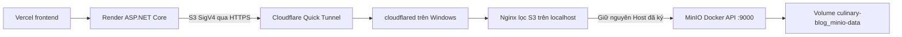

# Demo MinIO local qua Cloudflare Quick Tunnel

Cập nhật 27/10/2026. Dành cho demo môn học; máy Windows/Docker và tiến trình tunnel phải còn chạy. Không tạo bucket mới, không thay volume hoặc đổi PostgreSQL/Redis.

Checkpoint mới: Render đã chạy commit `2ed7f42`, `/health/live` và `/health/ready` trả200. Tunnel cũ mất DNS sau khi gateway/cloudflared dừng. Đã khôi phục đúng gateway có sẵn, giữ nguyên MinIO/IAM/bucket/credentials; tunnel mới đọc ảnh khớp byte với local và chặn anonymous/Admin/Console. Chưa đổi Render Environment. URL hiện tại nằm trong `tmp/minio-tunnel/session.json` và file riêng `tmp/minio-tunnel/render-minio.env`; chỉ đổi `ObjectStorage__Endpoint` trên Render rồi áp dụng deployment. Xem [evidence sau deploy](docs/operations/render-metadata-deployment-result.json). Recovery lần này không chạy lại upload/delete hoặc restart MinIO.

## 1. Hiện trạng và kiến trúc



- Container hiện tại: `culinary-blog-minio-1`; API `http://localhost:9000`; Console `http://localhost:9001`. **Không tunnel Console** và không mở port forwarding trên router.
- Dữ liệu ở named volume `culinary-blog_minio-data`, mount `/data`, bucket hiện có `culinary-media`, private, đã bật versioning. Script chỉ khởi động container có sẵn nếu đang dừng, không tạo container MinIO/bucket/volume.
- Backend dùng **Minio .NET SDK 7.0.0**. `DependencyInjection.cs` lấy endpoint bằng environment, dùng hostname/port và `.WithSSL(true)` khi scheme là HTTPS.
- Upload/read/delete đi qua `IFileStorageService` → `MinioFileStorageService`. Ảnh trả về URL tương đối `/api/v1/media/{id}/{variant}`; backend kiểm quyền rồi stream ảnh. Không trả hostname MinIO/localhost cho frontend. Dự án hiện **không dùng presigned URL**.
- MinIO local đang dùng root credential development. Mở thẳng cổng9000 qua tunnel sẽ đưa credential mặc định vào bề mặt truy cập Internet. Vì vậy demo có Nginx nhỏ phía trước API: chỉ chuyển tiếp bucket đã chọn và Authorization SigV4 của user demo; chặn root, Admin API, Console, bucket khác và truy cập ẩn danh. MinIO vẫn tự xác minh chữ ký; lớp lọc không thay thế xác thực MinIO.
- User demo chỉ có `GetBucketLocation`, `ListBucket` trên bucket này và `GetObject`, `PutObject`, `DeleteObject` trên object của bucket. Không cấp quyền admin, tạo bucket, đổi policy hoặc xóa phiên bản. Dùng bucket này cho dữ liệu demo.

## 2. File và thay đổi

Không sửa code nghiệp vụ, SDK, `Program.cs`, Dockerfile, Compose hoặc cấu hình database. Cơ chế HTTPS hiện có đã đủ.

| File | Vai trò |
|---|---|
| `scripts/start-minio-tunnel.ps1` | Kiểm MinIO/volume/private bucket, tạo hoặc tái dùng user demo, chạy gateway và Quick Tunnel, xuất bốn biến Render riêng. |
| `scripts/stop-minio-tunnel.ps1` | Dừng đúng process cloudflared/container gateway của session; giữ MinIO, volume, bucket và user demo. |
| `infra/demo/minio-tunnel.nginx.conf.template` | Template không chứa key thật, giữ Host/path/body khi proxy để bảo toàn SigV4. |
| `tools/MinioTunnelProbe` | Dùng chính DI/adapter backend để kiểm ảnh mẫu qua HTTPS, không khởi động API/jobs hoặc kết nối DB/Redis. |
| `DEMO_MINIO_TUNNEL.md`, `README.md` | Hướng dẫn demo và liên kết từ trang chính. |
| `docs/operations/minio-tunnel-evidence-2026-10-26.json` | Kết quả đã chạy, giới hạn bằng chứng và hash artifact, không chứa credential. |
| `tmp/minio-tunnel/render-minio.env` | **File riêng, Git ignore**: bốn biến MinIO để nhập Render, có secret; không chụp ảnh/dán chat/commit. |
| `tmp/minio-tunnel/session.json` | URL/PID/container gateway của phiên hiện tại, không chứa credential. |

`backend/.env` đã cập nhật bốn giá trị MinIO của lần kiểm hiện tại, giữ nguyên các trường khác. Lần mở tunnel tiếp theo, nguồn giá trị đúng là `tmp/minio-tunnel/render-minio.env`; không nhập nguyên file backend có placeholder vào Render. ASP.NET Core không tự nạp `.env`.

## 3. Khởi động trước buổi demo

Mở Docker Desktop ở chế độ Linux containers. Chạy PowerShell tại gốc repository:

```powershell
Set-Location D:\Culinary_Blog
powershell -NoProfile -File scripts/start-minio-tunnel.ps1
```

Đã tìm thấy bản portable `cloudflared`2026.10.3 tại `tmp/g04/preview/tools/cloudflared.exe`; không cài thêm phần mềm hệ thống. Nếu dùng máy khác, xin phép người quản lý máy trước khi tải/cài từ [Cloudflare Downloads](https://developers.cloudflare.com/tunnel/downloads/), rồi truyền đường dẫn:

```powershell
powershell -NoProfile -File scripts/start-minio-tunnel.ps1 -CloudflaredPath C:\Tools\cloudflared.exe
```

Script kiểm gateway local đạt200 trước khi mở tunnel. Nó chỉ bind gateway vào `127.0.0.1` ở cổng ngẫu nhiên, chạy Nginx read-only/không quyền root, không ghi access log và không bật cloudflared debug log. Không dùng `--http-host-header localhost` hoặc ép Host thành `minio:9000`: Host là một phần chữ ký S3. Không thêm path `/s3` hay tên bucket vào endpoint.

Nếu script báo đã có session, dùng phiên đó hoặc dừng đúng script rồi mở lại. Không xóa `render-minio.env` tùy tiện: đây là credential demo được tái dùng giữa các phiên.

Quick Tunnel không cần tài khoản/domain Cloudflare; URL ngẫu nhiên thay đổi khi tạo phiên mới, không có SLA, giới hạn200 request đang xử lý và không hỗ trợ SSE. Đây không phải môi trường production. Không bật xác thực email tương tác cho URL S3 vì SDK không đăng nhập bằng OTP.

## 4. Bước thủ công trên Render

**Chưa tự thay biến trên Render.** Sau phê duyệt riêng, main/auto-deploy đã đưa commit `2ed7f42` lên Render và kiểm release/health/API đọc đạt. Với lỗi DNS tunnel mới nhất, chỉ sửa endpoint; giữ AccessKey/SecretKey/BucketName đã nhập. Bảng bốn biến bên dưới dành cho lần cấu hình MinIO đầu tiên.

1. Vào **Render Dashboard → Web Service `culinary-blog-api` → Environment**.
2. Chọn **Edit/Add Environment Variables → Add from .env** (tên nút có thể khác theo giao diện).
3. Dùng riêng file `tmp/minio-tunnel/render-minio.env`, hoặc nhập bốn biến bên dưới. Giữ tất cả biến Database/Redis/JWT/revalidation khác.

| Tên chính xác | Định dạng giá trị |
|---|---|
| `ObjectStorage__Endpoint` | `https://<ten-ngau-nhien>.trycloudflare.com` — URL của session đang chạy, không `/culinary-media`, không localhost. |
| `ObjectStorage__AccessKey` | Giá trị user demo trong file riêng; không dùng root key từ `.env` Docker. |
| `ObjectStorage__SecretKey` | Secret demo tương ứng trong file riêng. |
| `ObjectStorage__BucketName` | `culinary-media`. |

4. Khi đã sẵn sàng áp dụng cấu hình cloud, người dùng chọn **Save, rebuild, and deploy** hoặc thao tác triển khai tương ứng trên Render. Agent chưa thực hiện bước này.
5. Lỗi guard của source cũ `7ed7a58` đã được xử lý bằng metadata provider Render được duyệt riêng: `Release__Provider=Render`, nhận commit/service/instance thực từ các biến nền tảng `RENDER_*`. Không nhập digest giả hoặc đổi sang Development. Giữ cấu hình Neon/Upstash và ba cờ tắt migration/seed/jobs; không dùng nguyên source working tree chưa commit với sáu migration pending. Xem [hướng dẫn metadata](docs/operations/render-release-metadata.md). Docker provider và các release gates vẫn giữ nguyên.

6. Sau khi service thật sự Ready, gửi URL backend hoặc tự kiểm `/health/live`, `/health/ready`, `/health`. `/health` bao gồm MinIO cùng dependency khác; lỗi tổng hợp không tự chứng minh MinIO hỏng. Log phải phân biệt lỗi guard/DB/Redis và lỗi S3, không bật log request có Authorization.

## 5. Khi URL tunnel đổi

```powershell
powershell -NoProfile -File scripts/stop-minio-tunnel.ps1
powershell -NoProfile -File scripts/start-minio-tunnel.ps1
```

Đọc URL mới ở output/session.json hoặc file env riêng. User demo/secret/bucket được tái dùng; chỉ cần cập nhật **`ObjectStorage__Endpoint`** trong Render Environment và để người dùng áp dụng lại deployment. Chờ API Ready rồi thử ảnh mới. URL/connection client được tạo từ cấu hình startup nên sửa file trên PC không tự cập nhật process Render.

Không thay hostname của một request S3 đã ký hoặc presigned URL. Hiện dự án không sinh presigned URL nên không cần sửa luồng này; nếu thêm trong tương lai phải ký bằng hostname công khai và rà lại gateway (hiện chỉ nhận Authorization header, không nhận query presigned).

## 6. Kiểm chức năng và demo cho giảng viên

Probe độc lập có thể chạy trước khi cấu hình Render xong, cần .NET SDK10:

```powershell
dotnet run --project tools/MinioTunnelProbe -c Release -- hold tmp/minio-tunnel/render-minio.env tmp/minio-tunnel/probe-next.json
dotnet run --project tools/MinioTunnelProbe -c Release -- verify-delete tmp/minio-tunnel/render-minio.env tmp/minio-tunnel/probe-next.json
```

`hold` ghi một PNG1×1 ngẫu nhiên dưới prefix `demo-tunnel/<guid>/pixel.png`, kiểm exists/list/SHA-256, để lại ảnh cho bước sau. `verify-delete` đọc lại, so hash rồi xóa lặp lại và kiểm không còn object hiện hành. Checkpoint chỉ nhận key có đúng mẫu prefix demo; không dùng tool với ảnh thật. Nếu chạy lại một lượt đã xóa, dùng tên checkpoint mới. Probe không tạo bucket hay đổi DB. MinIO versioning giữ phiên bản cũ/delete marker sau S3 DeleteObject; đó không phải ảnh còn truy cập được. Không tự purge phiên bản ảnh ứng dụng.

Sau khi Render được cấu hình đầy đủ, demo qua frontend:

1. Đăng nhập tài khoản demo, mở recipe demo thuộc tài khoản đó.
2. Upload JPEG/PNG/WebP/AVIF ≤5MiB; quan sát request upload thành công.
3. Xem object mới tại **MinIO Console local** (`localhost:9001`) trong bucket hiện có; giữ Console trên máy cá nhân.
4. Xem ảnh qua frontend và network request `/api/v1/media/...`; chờ job nếu muốn xem medium800×600/thumbnail300×300. Không đưa URL localhost hoặc secret vào trình duyệt frontend.
5. Xóa ảnh từ UI; kiểm metadata/UI, tác vụ nền và object hiện hành không còn truy cập được. Chờ outbox nếu xử lý bất đồng bộ.
6. Nếu cần kiểm lại persistence, có thể `docker restart culinary-blog-minio-1` rồi chờ health; **không** `docker compose down -v`, không `rm` volume hoặc chạy bootstrap tạo lại bucket. Dự liệu downtime vài giây cho các client đang dùng MinIO.

## 7. Kết quả đã thực thi ngày26/10/2026

| Kiểm | Kết quả và phạm vi bằng chứng |
|---|---|
| MinIO local API và private/versioning/volume | Đạt; API200, private, versioning enabled, đúng named volume `/data`. |
| Quick Tunnel HTTPS | Đạt; health200 qua public hostname. Không dùng `--no-tls-verify`. |
| SDK backend upload/download/list | Đạt bằng chính `AddInfrastructure`/`MinioFileStorageService`, Minio7.0.0, HTTPS và user demo; PNG byte-exact. |
| Restart không mất dữ liệu | Đạt; cùng container/volume, catalog661 entry phiên bản hiện có và SHA-256 một ảnh cũ khớp trước/sau restart; ảnh PNG demo vẫn đọc được qua tunnel sau restart. |
| Delete | Đạt; xóa lặp lại qua SDK/tunnel, exists=false; agent đã dọn riêng các version của PNG mẫu do lượt kiểm tạo, không xóa dữ liệu có sẵn. |
| Quyền tối thiểu | Đạt: anonymous bucket/root/Admin403; request root SigV4 hợp lệ cũng403 ở gateway; user demo list bucket200 nhưng đọc bucket policy403 ngay tại MinIO local. |
| Presigned URL | Không áp dụng: source hiện không gọi chức năng presigned. |
| Render → tunnel và UI Vercel upload/xóa | **Chưa kiểm được**: ảnh Render báo startup failure, chưa có URL backend hoạt động hoặc biến cloud đã được người dùng áp dụng. Probe local qua Internet không thay bằng chứng Render. |

URL đã kiểm: `https://marvel-kentucky-quebec-newspaper.trycloudflare.com`. Đây là quan sát của session, không phải hostname cố định; ưu tiên URL hiện tại trong session.json. Bằng chứng không chứa credential tại [minio-tunnel-evidence-2026-10-26.json](docs/operations/minio-tunnel-evidence-2026-10-26.json); log/probe/catalog riêng nằm trong `tmp/minio-tunnel/` được Git ignore. Backend source không đổi nên giữ các regression backend227/frontend/ISR trước trong phạm vi cũ, không chạy lại để nhận nghiệm thu Render.

## 8. Lỗi và khôi phục

| Hiện tượng | Kiểm và cách xử lý |
|---|---|
| Không có cloudflared | Truyền `-CloudflaredPath`; chỉ cài/tải khi đã được phép. Không cần login Cloudflare. |
| Quick Tunnel không tạo URL | Xem cloudflared.err.log mức info; kiểm Internet/firewall/HTTPS443 và cấu hình cloudflared có sẵn. Script dùng HTTP/2, không cần mở inbound port. Không bật debug vì có thể log headers. |
| `502` | Kiểm MinIO health, gateway còn running và health trên localhost gatewayPort. Gateway thất bại thì script mới sẽ dừng trước khi mở tunnel. Không đổi credential khi lỗi thật là origin down. |
| `403` khi mở bucket trên browser | Bình thường: anonymous bị chặn. Dùng backend/probe với file env riêng; không đổi bucket sang public. |
| `InvalidAccessKeyId`/`AccessDenied` từ SDK | Kiểm user/secret đúng cặp trong file riêng, bucket đúng và user còn enabled; root bị gateway chặn có chủ đích. Không chép credential vào log/chat. |
| `SignatureDoesNotMatch` | Dùng HTTPS URL hiện tại không có path, giữ Host công khai qua cloudflared/Nginx; không dùng http-host-header localhost, không viết lại URL đã ký; đồng bộ giờ Windows. |
| `/health/live` Render vẫn lỗi/startup thoát | Xử lý đúng guard/dependency trong logs; MinIO tunnel hoạt động không tự sửa Database/Redis/Release/AllowedHosts. |
| Tunnel hết hoạt động hoặc máy sleep | Bật lại Docker/MinIO, chạy stop/start, cập nhật endpoint Render. Giữ máy thức/cắm nguồn trong demo. |
| Script stop báo identity thay đổi | Không kill PID/container theo tên đoán. Đối chiếu session và process/container label trước; script chủ động từ chối để tránh dừng nhầm ứng dụng khác. |

Kết thúc buổi demo: chạy stop script. Script không dừng MinIO và không xóa user/policy demo; credential vẫn chỉ có quyền trong bucket, có thể tái dùng cho phiên sau hoặc thu hồi riêng trong Console local khi không cần nữa. Không để tunnel chạy không cần thiết.

Nguồn đã đối chiếu: [Cloudflare Quick Tunnels](https://developers.cloudflare.com/tunnel/get-started/quick-tunnels/), [MinIO SDK7 endpoint/SSL](https://github.com/minio/minio-dotnet/blob/7.0.0/Minio/MinioClientExtensions.cs), [MinIO IAM](https://docs.min.io/aistor/administration/iam/). Cú pháp/quyền được kiểm thực tế với MinIO2025-09-07, mc2025-08-13, cloudflared2026.10.3 và Nginx1.28.0 đang có trên máy.
